本文整理自高工人形机器人年会上的演讲。<a href="gaogong.pdf" download="gaogong.pdf">下载演示文稿 PDF（6.4 MB）</a>

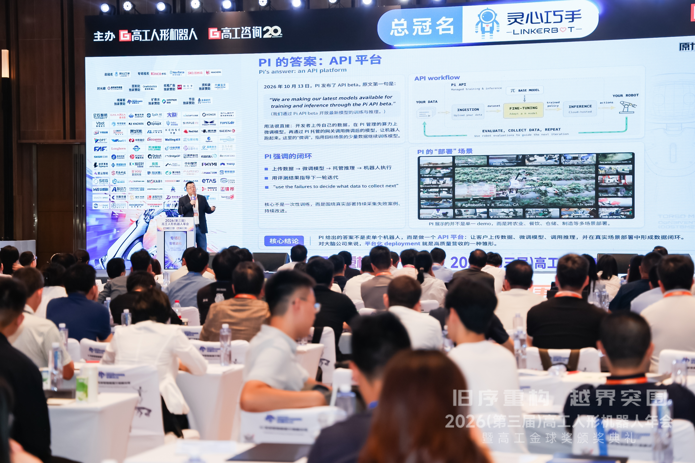

---

> 具身智能是不是泡沫？这个问题问错了。该问的是：技术进步能否在合理时间内、一步一步地变成商业价值。本文先给出泡沫的定义，再看行业正在押注的部署路径，最后把具身的 scaling 拆成三条线：data scaling、model scaling、deployment scaling。它们各自作用在泡沫公式的不同部分。
>
> 本文同时写给投资人和技术读者。正文尽量不依赖技术背景；每章末尾的“技术注”交代实验口径与证据边界，供需要核对的读者参考，跳过不影响主线。

---

## 一、泡沫是差距乘以时间

泡沫到底是什么？我的定义是：

**泡沫 = 能力差距 × 弥合时间**

“能力差距”指现在的技术能做到的，和人们期待它做到的之间的距离。“弥合时间”指把这段距离走完需要多久。

只看能力差距是不够的。如果一个差距一年之内就能弥合，那它算不上泡沫。如果需要十年，那么在前五年里，它就是泡沫。原因在于资本有时间价值。

所以，正确的问题不是“具身是不是被高估了”，而是：

> **当前的具身能力，能否在合理时间内产生有商业意义的价值？技术每进步一点，商业价值能不能跟着多一点？**

两个条件都满足，就不是泡沫；有一个不满足，就是。

什么叫“有商业意义的价值”？我的标准是同时满足两条：机器人的 throughput——单位时间内完成的工作量——超过人类熟练工；投资回收期在 2 到 3 年。能做出来，不等于能算过账。

用这把尺子量一下今天的具身。Anthropic 在 2026 年 9 月 30 日发布的研究 *What work can robots do?* 给了一组很能说明问题的数字。

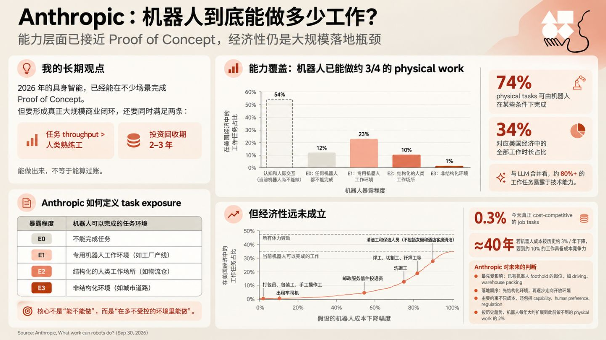

*根据 Anthropic，What work can robots do?（2026-09-30）整理。*

先看能力。Anthropic 按机器人能在什么样的环境里完成任务，把工作任务分成几档：专用的机器人工作环境（如工厂产线）、结构化的人类工作场所（如物流仓）、非结构化环境（如城市道路）。按这个口径，美国经济中约 74% 的体力工作任务，在某些条件下已经可以由机器人完成，对应全部工作时长的约 34%。只看能力，具身已经不是“做不出来”。

再看经济性。同一份研究估算，今天在成本上真正有竞争力的工作任务只占约 0.3%。

这组数字几乎就是泡沫公式的注脚。能力差距不在“能不能做”，而在“能不能在有商业价值的场景里、以算得过账的成本做”；弥合这段差距的时间，如果只靠机器人成本按历史速度下降，要以十年计——这还没有算上模型和数据的进步。

以此衡量，当前具身市场有相当一部分是泡沫。不是因为技术做不到，而是因为做到所需的时间，比当前融资规模所假设的更长。

这不是唱衰。这个定义把问题从“方向对不对”变成了“时间够不够”，而时间是可以缩短的。后文要讨论的，正是哪些 scaling 方式在缩短这段时间，以及它们能否让价值随技术进步一步一步地兑现。

---

## 二、高质量营收：大脑公司的答案是部署

具身的投资热度已经明显回落。行业里正在形成一个共识：靠融资讲故事的阶段过去了，接下来要看“高质量营收”。

什么样的营收算高质量？可以用一组对比来说明。

**低质量的营收**：一次性的项目制交付、演示订单、科研采购。它们也是收入，但每个项目都要单独投入工程人力，收入随人头线性增长，与模型本身的进步关系很弱。模型变强了，下一个项目仍然要从头做一遍。

**高质量的营收**：可复制、可续费。更重要的是，它随基座模型能力的进步而增长。这里的“基座模型”，指用大量数据预先训练、能用到很多场景的通用具身模型。

这个区分正好对应上一章的第二个条件。项目制收入与技术进步脱钩，高质量营收与技术进步挂钩。

今天行业的营收，大部分还在前一类。以宇树为例：按其招股书披露，2025 年前 9 个月的营收中，科研与教育占 73.6%，其他占 17.4%，工业部署只占 9%。

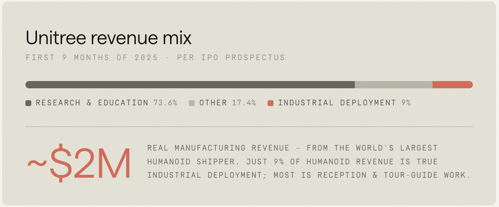

*来源：宇树科技招股书。注意：这是 2025 年前 9 个月的营收分布，不代表全年，也不代表之后的结构。*

宇树是头部的人形机器人本体公司，不是大脑公司。它的营收结构反映的不是某一家公司的问题，而是行业所处的阶段：大部分收入来自科研与教育采购，真正在生产环节里干活的部署还很少。

对大脑公司来说——也就是做“理解任务、决定怎么做”的通用模型的公司——高质量营收只有一个来源：不断开拓新场景，并在场景里部署。行业里常说“场景落地”，下文统称为**部署**：模型在真实客户场景里持续干活、持续产生收入。这里的“场景”，指一个具体客户的一类任务和环境。

问题是：部署怎么规模化？一个场景一个场景地做项目，又回到了项目制。Physical Intelligence（PI）给出的答案是：把大脑做成 API 平台。

### PI 的答案：API 平台

2026 年 10 月 13 日，PI 发布了 API beta。开发者上传自己的数据，在 PI 的算力上微调模型（“微调”指用目标场景的少量数据继续训练模型），再调用 PI 托管的模型让机器人跑起来；评测中的失败案例，用来决定下一轮采什么数据。

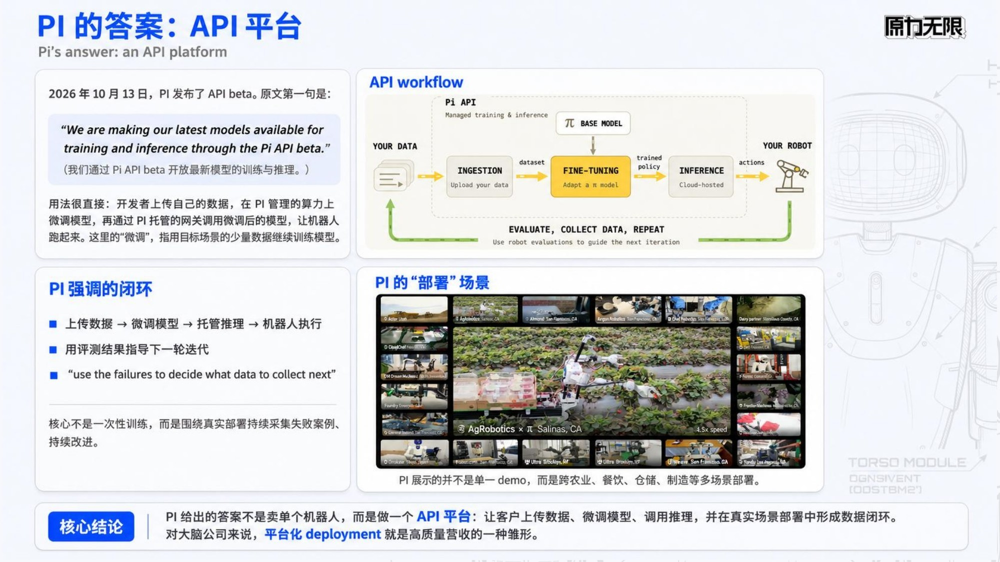

*作者整理。工作流图与部署场景截图来自 Physical Intelligence，Pi API beta 发布页。*

PI 展示了几个合作方的例子。Actor 做自动驾驶的重型机械，它的无人轮式装载机在一个真实的商业部署中铲料、装车，驾驶室里没有操作员。Almond 做双臂机器人 Axol，演示中 Axol 给自家装配用的垫片去毛刺，所用的模型是团队“iterating with the Pi API for four days”——用 API 迭代四天得到的。PI 还提到，这些应用分布在日本、瑞士和美国多地，多数通过云端推理运行；早期部署也暴露了需要改进的地方，包括部分场景的网络连接问题。

PI 对这次发布的定位是：

> “Launching the beta is our first step in providing the physical intelligence foundation the community can build upon.”
> （发布 beta 是我们为社区提供可以在其上构建的物理智能基座的第一步。）

熟悉国内本体企业的读者会觉得这个模式眼熟。在小脑层面——也就是负责把动作执行好的运动控制层——本体企业已经有了面向开发者的平台，例如智元的灵创平台，提供动作编排能力和二次开发生态。PI API 是大脑层面对应的东西：把基座模型的能力开放出去，让开发者在上面做场景的二次开发。

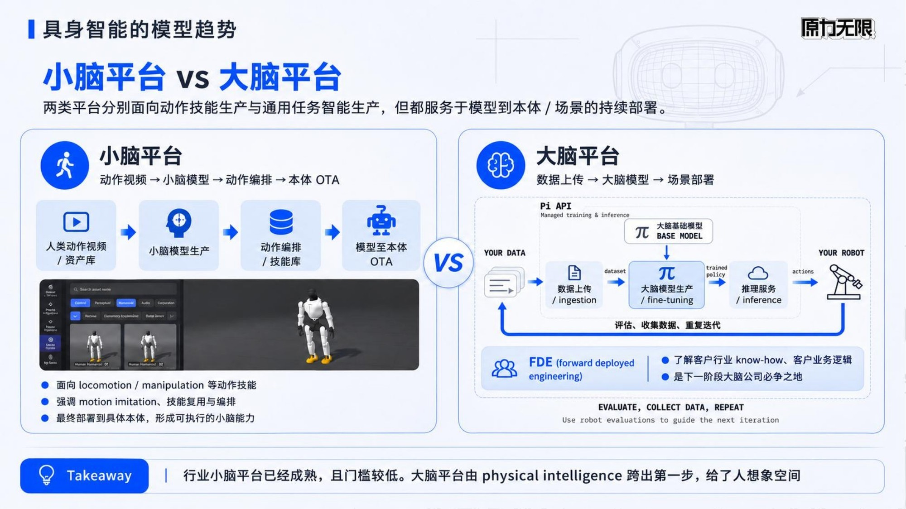

*小脑平台与大脑平台的对比（作者整理）。右侧流程根据 Physical Intelligence Pi API beta 发布页绘制；下方 FDE 一栏是本文的判断，不是 PI 发布的产品内容。*

值得注意的是 PI 开放的是什么。它不是一个“开箱即用”的通用模型，而是一整套**适配**能力：数据上传、托管微调、托管推理。“适配”指让基座模型学会一个新场景的活儿所需的额外投入。PI 的产品形态隐含了一个判断：今天的基座模型，还不能不经适配就进入一个具体场景。

由此看，一个大脑平台需要三项能力：

1. **基座模型的能力。** 各个场景里实际干活的模型，都要从一个强大的基座模型微调而来。基座越强，每个场景需要的适配越少。
2. **平台能力**，即 AI infra：训练和推理背后的整套系统，负责管理数据和模型的全生命周期。数据这一侧，是采集、上传、清洗，以及用评测中的失败案例决定下一轮采什么；模型这一侧，是微调、评测、版本升级和托管推理。
3. **部署能力。** 触达具体行业、把模型真正部署进客户业务的能力。这种做法叫 **FDE**（forward deployed engineering）：工程师驻到客户现场，了解客户的行业 know-how 和业务逻辑，把模型接进客户的业务流程。

PI API 开放出去的，是前两项。第三项容易被误解成“一个场景一个场景地做项目”，区别在于分工：大脑公司只在少数大客户（KA）那里用 FDE 亲自部署，做出样板；规模化的部署，靠平台能力赋能合作的生态公司去做。第六章会展开这个分工。

三项能力里，决定部署能否规模化的关键变量是适配成本：基座越强、平台越完善，每个场景需要投入的人力就越少，生态公司也就越做得起。而适配成本降得多快，取决于底层的 scaling 怎么做。

---

## 三、具身 scaling 的三条线

“Scaling”在大语言模型里已经是共识：更多数据、更大模型、更多算力，能力就会稳定提升。具身智能有没有同样的规律，是这两年讨论最多的问题之一。

本文换一个问法：不只问能力会不会随投入增长，而是问每一种投入，作用在第一章泡沫公式的哪一项。按这个问法，具身的 scaling 可以拆成三条线，各自要回答一个问题。

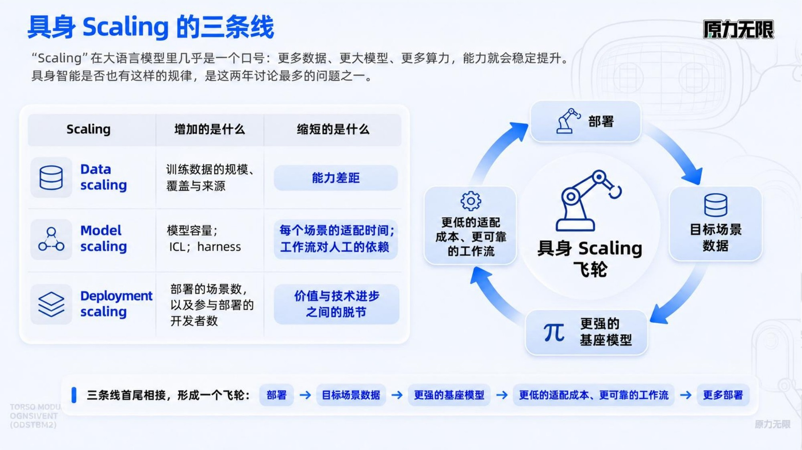

*作者整理。*

**第四章，data scaling：数据越多，基座模型越强吗？应该 scale 什么样的数据？** 训练曲线变好看不算数，要看这份提升能不能保留到机器人实际干活的时候。数据也不只是小时数：覆盖多少场景、来自人还是机器人，价值差别很大。

**第五章，model scaling：基座模型进入新场景，能直接用吗？微调以后涨得多快？** 我们对基座模型的期望有两个：**泛化性**，即到了没见过的场景也能干活；**可微调性**，即用少量目标场景（要部署的那个具体场景）的数据微调以后，性能能快速提升。具体看两件事：模型能否 zero-shot（不给示范）或 one-shot（只看一次示范）就进入目标场景；few-shot（给少量示范）微调以后，性能提升的“斜率”有多陡，也就是每多一点数据，性能涨多少。

**第六章，deployment scaling：收入能不能随基座模型的进步增长？** 这是第一章的第二个条件。这一章看部署如何从一个场景一个场景地做项目，变成平台加生态，让技术每进步一点，商业价值也跟着多一点。

---

## 四、Data scaling：能规模化的是人类数据

### 4.1 先说结论：训练配方与数据金字塔

先说结论。下面两页是我们研发团队目前的实践。

*作者团队整理。*

具身基座模型的训练不是一步完成的，而是一套分阶段的**训练配方**（training recipe）：每个阶段喂不同的数据，学不同的东西。

- **Pretraining（预训练）**：用互联网规模的图像、视频和文本，加上开源的第三方机器人遥操作数据，学通用的视觉理解、世界知识，以及“动作大概该怎么做”的基本常识。
- **Midtraining**：用高质量的第一人称人类操作数据，以及特定领域的操作数据，注入操作经验和任务、场景知识，让模型的操作能力对齐到具身任务上。
- **Posttraining**：在真实机器人上，通过交互和奖励继续训练，提升成功率和泛化。

每个阶段用什么数据、用多少，构成了一座**数据金字塔**。

*左：NVIDIA 在 GR00T N1 中提出的数据金字塔；右：作者团队的数据金字塔。*

金字塔越往下，数据量越大、越便宜、越通用；越往上，数据越少、越贵，但和要部署的机器人、场景越贴近。我们的金字塔分三层，分别对应训练配方的三个阶段：

- **底层**：只有视频、没有动作标注的人类数据，加上开源的第三方本体遥操作数据；
- **中层**：带动作标注的人类操作数据，以及**目标场景数据**——在要部署的场景里、用要部署的机器人采的数据；
- **顶层**：physical RL，机器人在真实环境里自己干活，出错时由人接管、示范正确做法，再继续训练。

这里的**人类数据**，指人手操作时采集的视频和手部动作，采集时不需要机器人。和 NVIDIA 的版本相比，最大的不同在中间一层：NVIDIA 用仿真生成的合成数据，我们用带动作标注的人类操作数据和目标场景数据。

两页合起来，结论是：训练配方的每个阶段对应金字塔的一层，各层的构成可以系统地设计；三层里能真正大规模扩充的，是底层和中层的人类数据。下面几节给出支撑这个结论的公开证据。

### 4.2 最显而易见的 scaling：数据、参数、算力

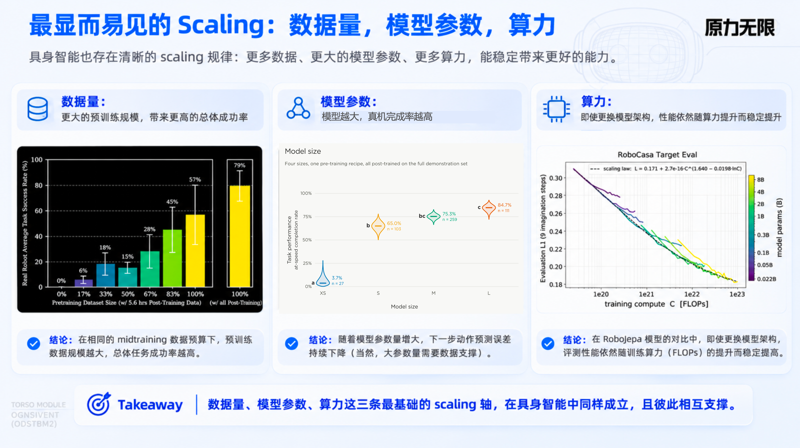

*作者整理。左：Generalist，GEN-0，Figure 3；中：Rhoda AI，Figure 4；右：Zholus et al.，RoboJEPA，Figure 5。*

具身也能看到这三条最基本的 scaling 趋势，只是证据比语言模型少得多：

- **数据量**（左图）：GEN-0 用不同规模的数据预训练基座模型，再统一用 5.6 小时的目标任务数据微调，然后上真机测试，也就是让真实机器人实际执行任务。预训练数据从零增加到全量，平均真机成功率从 0% 提高到 57%。
- **模型参数**（中图）：Rhoda 用同一套预训练配方训练了四个大小的模型，再用同一份示范数据微调。在一项真机工业任务上，不需要人工干预、且在 100 秒内完成的比例，从最小到最大的模型依次是 3.7%、65.0%、75.3%、84.7%。
- **算力**（右图）：RoboJEPA 训练了 2200 万到 80 亿参数的一组模型。算力增加时，预测误差持续下降；小模型较早停滞，大模型能继续吃下更多算力。

但这三条线不是各自独立的。更大的模型、更多的算力，要有足够的数据喂才能发挥作用；数据跟不上，加参数、加算力都事倍功半。所以具身 scaling 的瓶颈，最终落在数据上：什么数据能便宜地扩充到足够大？我们的答案是人类数据。下面几节看消融实验的证据。

### 4.3 人类数据提升真机表现

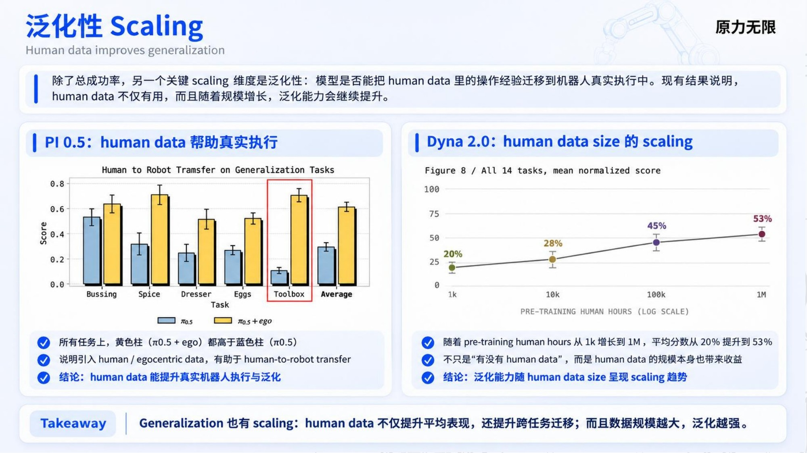

*作者整理。左：Kareer et al.（Physical Intelligence），Emergence of Human to Robot Transfer in VLAs；右：Dyna Robotics，Dyna-2，Figure 8。*

两张图测的都是**真机表现**，即机器人实际执行任务的结果。

**有没有人类数据（左图）。** PI 在 π0.5 上做了一组消融：同一个已经用机器人数据预训练好的基座，下游训练时只用机器人数据，或者再加上人类数据，然后在一组考察泛化的任务上测真机得分。五个任务上，加入人类数据都更好，平均得分从约 0.3 提高到约 0.6。

**人类数据有多少（右图）。** Dyna-2 固定模型结构和训练配方，只改变预训练用的人类数据量，从 1 千小时增加到 100 万小时，再用同样的机器人数据微调。14 个真机任务的平均归一化得分，从 20% 依次提高到 28%、45%、53%。

左图说明人类数据有用，右图说明人类数据越多越有用。

### 4.4 人类数据能迁移到机器人身上

*作者整理。图中 Figure 5、Figure 7 来自 Dyna Robotics，Dyna-2 技术博客。*

人手和机器人手的结构不同。人类数据能用，前提是**跨本体迁移**（cross-embodiment transfer）成立：模型在人手上学到的操作经验，能搬到机器人身上。

Dyna-2 做了一个直接的检验。模型只用人类数据预训练，没有见过任何机器人数据，然后直接拿来预测机器人该怎么动，再和机器人遥操作采到的真实动作比较。这种不让机器人真的动、只比较预测轨迹和真实轨迹的评测，叫离线评测（open-loop），比出来的差距叫**离线误差**。

结果是：预训练的人类数据从 1 千小时增加到 100 万小时，在三组机器人数据上，离线误差都在下降，预测准确率都在上升（图中下方两张）。在没参与训练的人类数据上，预测也越来越准（图中左上四张）。

这一层证据比 4.3 弱一级：它说明人类数据学到的动作知识能转到机器人身上，但机器人没有真的动。4.3 的真机结果补上了这一环。两者合起来，才构成“人类数据越多，机器人越强”的完整证据。

### 4.5 遥操作数据不求多，但求多样

人类数据规模化以后，对多本体遥操作数据规模的需求大幅下降：不再需要为每一种机器人都采海量的遥操作数据。这是我们根据前两节证据得出的判断。

但遥操作数据不能不要。PI 的消融实验显示，机器人预训练数据越多样，人类数据迁移到机器人上的效果越好。

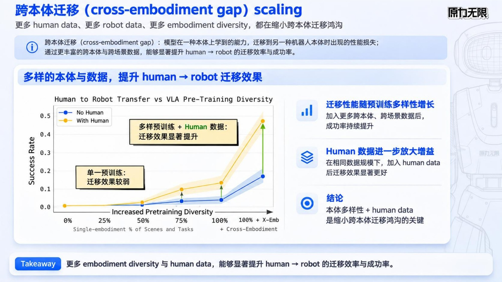

*作者整理。图表来自 Kareer et al.（Physical Intelligence），Emergence of Human to Robot Transfer in VLAs，Figure 1。*

PI 先用覆盖程度不同的机器人数据预训练出几个基座：从只覆盖一部分场景和任务，到覆盖全部场景和任务，最后一档再加入其他机器人本体的数据。然后对每个基座分别做两种下游训练：只用机器人数据，或者再加上同一份人类数据。

结果是：预训练覆盖很窄时，加不加人类数据几乎没有差别；覆盖越广，人类数据带来的提升越大。加入其他本体的数据以后，提升最明显，成功率从约 0.17 提高到约 0.47。换句话说，机器人数据的多样性，决定了模型能从人类数据里吸收多少东西。

这解释了 4.1 那座数据金字塔为什么这样构成：遥操作数据放在底层，用的是开源的第三方多本体数据，追求的是本体和场景的多样性，不靠自己大规模采集；规模交给人类数据。

### 4.6 什么样的人类数据有用：没有动作真值的视频也行，头部视角最关键

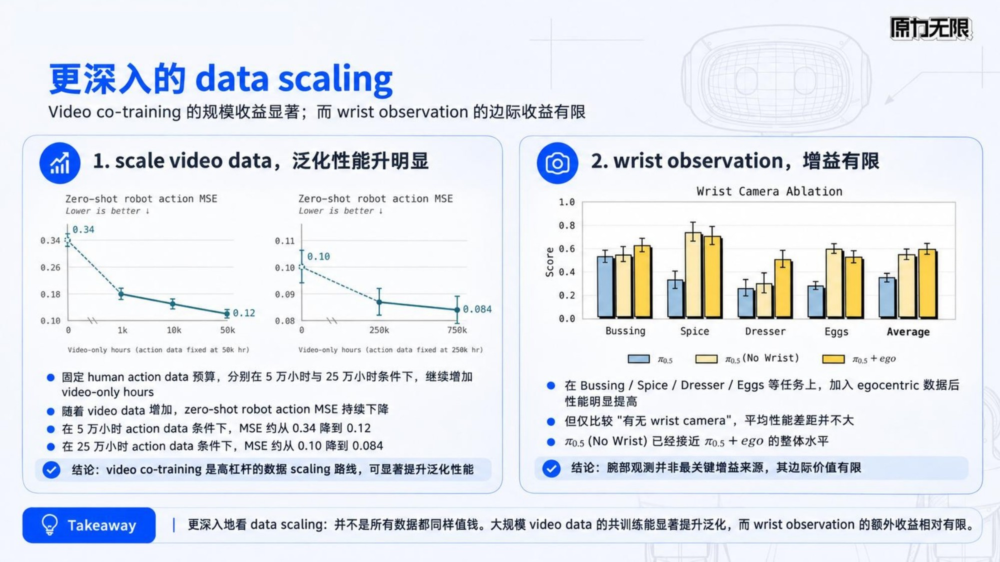

*作者整理。左：Dyna Robotics，Dyna-2，Figure 11；右：Kareer et al.（Physical Intelligence），Figure 12。*

人类数据内部也有高低之分。实践中常被问到两个问题。

**没有动作真值的视频，有没有用？（左图）** **video-only 数据**指只有第一人称视频、没有手部动作真值的人类数据。现实中这类数据往往质量参差：来自不同的数据供应商、不同的采集设备，**数据血缘**（数据从哪来、经过哪些处理的记录）也不完整。

Dyna-2 固定带动作标注的人类数据量（5 万小时和 25 万小时两档），只增加 video-only 数据，看模型在机器人数据上的 zero-shot 离线误差。两档条件下误差都在下降：5 万小时一档从约 0.34 降到 0.12，25 万小时一档从约 0.10 降到 0.084。动作数据更多的一档，视频带来的下降幅度小得多。

也就是说，即使没有动作真值，视频本身也能提升模型在机器人上的泛化。我们的判断是：质量参差、血缘不全的 video-only 数据，同样可以放进金字塔的底层。

**腕部视角重要吗？（右图）** 采集人类数据时，除了头部的第一人称相机，还可以在手腕或手持设备上加相机，例如手环相机、UMI 这类手持采集夹爪，得到**腕部视角**。PI 比较了三组：不加人类数据；加入只有**头部视角**的人类数据；加入头部加腕部视角的人类数据。只用头部视角，平均得分就从约 0.35 提高到约 0.55；再加上腕部视角，只到约 0.59。四个任务里，腕部视角在两个任务上有明显帮助，在另外两个上没有额外收益。

最关键的是头部视角，它带来了绝大部分收益。腕部视角是加分项，值不值得为它增加采集成本，要看任务。

### 4.7 小结

回到第三章的两个问题。

数据越多，基座模型越强吗？是的，而且这份提升能一路保留到真机上。

应该 scale 什么样的数据？人类数据。它不需要机器人，采集便宜，规模能做到百万小时；它越多，真机表现越好；它学到的操作经验，能迁移到机器人身上。具体到构成：

- 遥操作数据不求多，但求多样，它决定了人类数据能被吸收多少；
- 没有动作真值的 video-only 数据也有用，可以放心扩充；
- 采集人类数据，头部视角是必需的，腕部视角按任务取舍。

这些就是 4.1 那座数据金字塔的设计依据。

但人类数据解决的是基座模型这一层。一个更强的基座进入具体的客户场景，能不能直接用？微调以后涨得多快？这是第五章要回答的问题。

> **技术注：本章证据的口径**
>
> - **证据分层。** 离线误差的下降，不能直接推出真机表现的提升。本章的真机证据是 GEN-0 Figure 3、Rhoda Figure 4、PI 的三组消融（4.3、4.5、4.6）和 Dyna-2 Figure 8；RoboJEPA 与 Dyna-2 Figure 5、7、11 是离线指标。
> - **GEN-0 Figure 3。** 左侧七根柱固定 5.6 小时微调数据，是有效的对照；指标是盲测 A/B 评估的成功率，33%→50% 档位有一次下降（18%→15%）。右侧的 79% 使用了 550+ 小时微调数据，这部分提升来自目标任务数据，不是预训练，不能和左侧连成一条曲线。
> - **Rhoda Figure 4。** 原文没有公开四个模型的参数量。更大的模型在预训练中看了更多视频、用了更多算力，模型大小与算力的效果没有分开。单任务、单本体，每个条件只训练一次；M 与 S、L 之间在 95% 置信度上没有分开。指标是 at-speed completion：无人工干预、且周期在 100 秒内的完成率。
> - **RoboJEPA。** 扩大的是世界模型中的预测模块（视觉编码器固定），指标是九步预测的离线 latent 误差，不是真机成功率。
> - **PI 消融。** 人类数据是在下游训练阶段和机器人数据一起加入的，不是预训练阶段的消融；人类数据带有手部轨迹和子任务标注。纵轴是得分，不是成功率。图中含 Toolbox 共五个任务，论文主基准是四个任务，图中的平均值不等于论文的四任务均值。
> - **Dyna-2 Figure 8。** 14 个任务的平均归一化得分，不是成功率；单个任务并非都单调上升。
> - **Dyna-2 Figure 7。** 模型只用人类数据预训练，在三组机器人数据上 zero-shot 预测动作，与遥操作采到的真实动作比较；这是离线指标。
> - **PI Figure 1（4.5）。** 横轴改变的是机器人预训练覆盖的场景与任务，最后一档再加入其他本体的数据；0% 是从通用视觉语言模型初始化，不是从零训练。各档的人类数据保持不变，但机器人预训练的总数据量没有固定，不能把收益全部归因于多样性。数值为读图近似。“人类数据大幅降低了对多本体遥操作数据规模的需求”是本文根据 4.3、4.4 得出的判断，不是这张图直接测出的结论。
> - **Dyna-2 Figure 11（4.6）。** 指标是机器人数据上的 zero-shot 离线误差。零视频的基线只用动作数据训练（不含视频预测目标），所以从 0 到第一档的下降，同时包含“开启视频监督”和“增加视频数据”两个因素。Dyna 没有说明这些视频的来源和质量，“质量参差的视频也能用”是本文的推论。
> - **PI Figure 12（4.6）。** 改变的是训练所用人类示范是否含腕部视角，不是去掉机器人部署时的腕部相机。四个任务中两个受益、两个持平；数值为读图近似，未做显著性检验。
> - **配方同样重要。** Dyna 的消融显示，人类视频数据的收益依赖训练目标的设计（是否加入未来视频预测）与数据配比。

---

## 五、Model scaling：关键是 zero-shot、one-shot、few-shot

第三章说过，我们对基座模型有两个期望：泛化性和可微调性。落到能测的指标上，就是三个问题：zero-shot（不给示范）能不能直接进入目标场景；one-shot（只看一次示范）能做到多好；few-shot（给少量示范、做模型微调）以后涨得多快。第四章讲怎样把基座做强，这一章看基座怎样用到新场景。

### 5.1 从 BERT 到 ChatGPT：任务从写进权重，变成写进上下文

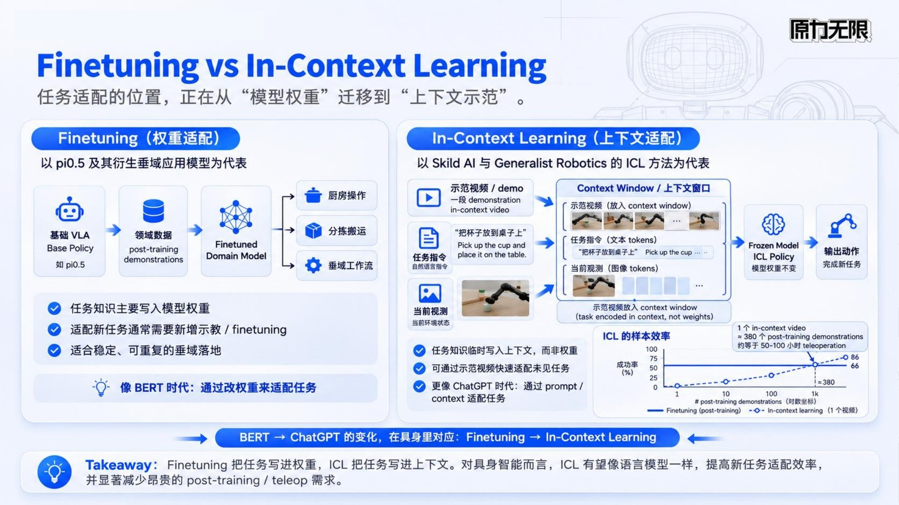

*作者整理。右下小图来自 Skild AI，Introducing S1，Figure 7。*

大语言模型经历过一次适配方式的变革。BERT 时代，每个新任务都要拿标注数据把模型微调一遍，任务知识写进模型权重。到了 ChatGPT 时代，给模型几句说明、举一两个例子，它就能做新任务，任务写进了上下文。后一种能力叫 **ICL**（in-context learning）：给模型看一遍演示，它就照着做，不需要改动模型本身。在机器人上，演示通常是一段视频。

具身正处在同样的分岔口。今天主流的做法是微调：从一个基础 **VLA** 出发（VLA 即视觉-语言-动作模型，看画面、读指令、直接输出动作，例如 PI 的 π0.5），用领域数据微调出各个场景的模型。另一条路是 ICL：Skild AI 和 Generalist 的做法，是把一段示范视频放进模型的上下文，模型权重不动，直接完成新任务。

我们在 ICL 上看到了类似 BERT 到 ChatGPT 的希望。Skild AI 在 2026 年 8 月发布的 S1 做了一组很干净的对比：两个模型使用相同的数据、相同的基本架构和相同的算力，唯一的区别是怎样告诉模型要做什么——一个看一段视频演示（ICL），一个只读语言指令。按第三章的说法，前者是 one-shot；后者在新任务上只有一句指令、没有示范，相当于 zero-shot。

S1 做了一个换算：在一个新任务上，让语言指令模型用越来越多的示范去微调，看它需要多少条示范才能追上 ICL 只看一段演示的效果。答案是大约 **380 条示范**，按他们的估算，相当于 50 到 100 小时的遥操作采集。

也就是说，一段演示的 one-shot 效果，抵得上约 380 条示范再加一轮模型微调。

### 5.2 ICL 的泛化：斜率更陡，退化更平滑，微调涨得更快

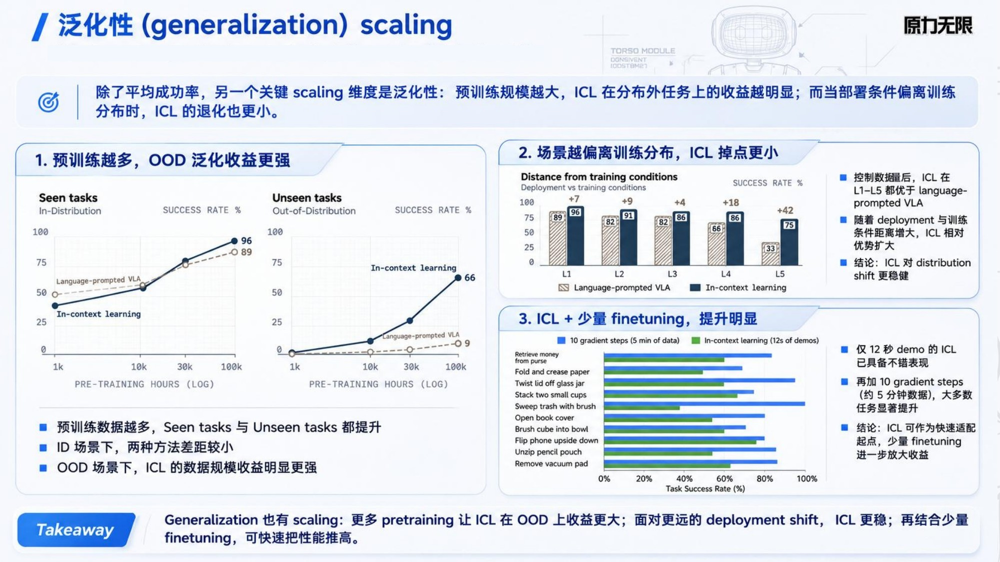

*作者整理。左、右上：Skild AI，Introducing S1，Figure 4、Figure 5；右下：Generalist AI，GEN-1.5，Figure 2。*

**新任务上的提升斜率（左图）。** 在训练时见过的任务上，两种模型差距不大：预训练数据达到 10 万小时时，ICL 得分 96%，语言指令模型 89%。但在**新场景**——训练时没见过的任务、环境或物体——里，差距非常大：ICL 66%，语言指令模型只有 9%。预训练数据增加时，ICL 在新场景上提升得快得多；在所测的范围内（到 10 万小时），还没有看到平台期。

**偏离训练条件时的退化（右上图）。** 部署环境离训练条件越远，性能下降在意料之中。S1 让同一个已知任务的部署环境逐级偏离训练条件（L1 到 L5）：从改变物体位置、换物体，一直到要求换一只手臂执行部分动作。ICL 的得分从 96% 依次降到 91%、86%、86%、75%，退化很平滑；语言指令模型从 89% 降到 82%、82%、66%，到最后一级只剩 33%。

**少量微调能涨多少（右下图）。** 如果允许 few-shot，也就是用少量数据做模型微调，还能再往上走。Generalist 在 GEN-1.5 中比较了同一个基座模型的两种适配方式：只看一段 3 到 12 秒的演示（one-shot），10 个短任务的平均成功率是 59%；每个任务用 5 分钟的数据（约 50 条示范）做 10 次模型更新（few-shot），平均成功率提高到 83%，多了约 24 个百分点。

真实客户现场几乎总是新场景，而且总会和训练条件有偏差。这三组结果，正好对应部署时最关心的三件事：没见过的任务能不能做，环境变了会不会突然失灵，给一点数据能涨多快。

### 5.3 小结

回到第三章对基座模型的两个期望：

- **泛化性**：在新任务上，看一段演示的 one-shot 远好于只给指令的 zero-shot（66% 对 9%），而且随预训练数据增加还在变好；环境偏离训练条件时，退化也更平滑。
- **可微调性**：在 one-shot 的基础上，再给 5 分钟数据做 few-shot 微调，平均成功率还能提高约 24 个百分点。

合起来看适配成本：一段演示抵得上约 380 条示范加一轮微调。适配一个新场景，正在从“采几十到上百小时数据、再训练”，变成“录一段演示，再加几分钟数据”。

模型侧的适配成本降下来以后，剩下的瓶颈不再主要是模型，而是：谁去成千上万个场景里做这件事？

> **技术注：本章证据的口径**
>
> - **Skild S1 的比较对象。** ICL 与语言指令模型使用相同的数据、架构和算力，只有告诉模型任务的方式不同；结论针对该研究的具体配方，ICL 与 VLA 并不是互斥的两类模型。把语言指令模型在新任务上的表现称为 zero-shot，是本文的对应。
> - **S1 的指标。** 得分按步骤累计，并允许人工恢复失败，不等于全程无干预的整任务成功率。Figure 4 的横轴是对数小时；“提升更快”“没有看到平台期”只描述所测区间（1 千到 10 万小时），不外推。
> - **380 条示范。** 是特定任务、特定基座下的交点，不是固定兑换率；ICL 的前提是大规模预训练，不能理解为“一条数据学会一个任务”。
> - **L1–L5。** 是不同类型的偏移设置，不是等间距的连续距离，不能据此定义统一的退化斜率。
> - **GEN-1.5。** 比较的是同一基座的两种适配条件，59%→83% 同时改变了数据量和更新步数，没有验证“先 ICL、再微调”的串行流程。其短任务成功率不能与 S1 的长任务逐步得分直接比较。

---

## 六、Deployment scaling：FDE 做样板，生态做复制

### 6.1 瓶颈转到了最后一公里

当模型侧的适配成本大幅下降以后，部署的瓶颈就转移到了“最后一公里”：选哪种本体和末端执行器、工位怎么改造、怎么接进客户现有的流程，还有网络、安全和客户验收。

这些事情有两个特点。第一，每个场景都不一样，很难被一家公司全部做完。第二，它们大多不是模型问题，而是工程和运营问题；PI 的早期部署就遇到了部分场景的网络连接问题。

所以第二章说，大脑平台除了基座模型和平台能力，还需要第三项能力：部署能力。

### 6.2 FDE：先在大客户那里做出样板

第二章提到的 FDE（forward deployed engineering），这个说法由 Palantir 推广开来。“forward deployed”原是军事用语，指部署在前线。Palantir 的做法是：软件不是交出去就走，而是把工程师直接派驻到客户那里，在客户现场理解业务、写代码、解决问题。

大模型公司这两年把这套做法搬了过来，OpenAI、Anthropic 都设有 FDE 岗位。按 OpenAI 的职位描述，FDE 团队“partners with customers to turn research breakthroughs into production systems”（和客户一起，把研究突破变成生产系统）。工程师和“most strategic customers”（最重要的战略客户）的工程与业务团队一起工作，从需求梳理、方案设计到上线全程负责，并把现场反馈带回产品和研究团队，让他们知道模型在哪里好用、哪里还要改进。

这里有两点值得注意：FDE 只服务最重要的客户；它的产出不只是这一单交付，还有带回公司的现场经验。

具身大脑公司面对的是同样的问题，而且更难：机器人要进入客户的物理现场，行业 know-how 和业务逻辑更分散。所以 FDE 对大脑公司同样必要，但只用在少数大客户（KA）那里。大脑公司派工程师驻场，亲自把模型部署进客户的业务流程，做出**样板**：证明一类场景能跑通，并摸清这类场景需要平台提供什么。

这和项目制的区别在于目的。项目制靠一单一单交付挣钱，做一百个场景就要一百份人力；样板只做第一个，后面九十九个由别人照着做。

### 6.3 终局：像本体加小脑一样的生态打法

谁来做后面的九十九个？小脑层面已经有了先例。本体公司提供产品化、平台化的能力：本体本身，加上动作编排平台和开发工具，例如第二章提到的智元灵创平台。生态公司和二开公司（在平台上做二次开发的公司）在上面开发具体的应用，把它复制到一个又一个场景里。

大脑层面的终局，应该是同样的分工。大脑公司把第二章的前两项能力，也就是基座模型和平台能力，做成产品开放给生态；集成商、二开公司，以及专做某个行业的部署公司，负责场景、运营和交付，把样板复制出去。PI API 的发布中列出了十多家合作方，覆盖从重型机械到制造的不同场景，可以看作这种分工的早期信号。

平台本身不需要拿下每个场景的交付。交付环节的价值，本来就应该由离客户更近的一方拿走。平台和生态公司是上下游，各自拿各自那一环的价值。

这个分工能成立，有一个前提：适配要足够便宜。如果每个场景仍然需要几百小时的数据和一支算法团队，生态公司就做不起。第五章讨论的 ICL 和少量微调，正是让生态能成立的条件。

### 6.4 平台让价值与技术进步挂钩

回到第一章的第二个条件：技术每进步一点，商业价值能不能跟着多一点？

在项目制交付下，答案通常是否定的。每个场景单独交付，模型升级以后，每个已交付的场景都要重新做一遍；收入取决于能投入多少工程人力，而不是模型有多强。

平台加生态改变了这个关系。以 PI API 为例，开发者在同一套“上传数据 → 托管微调 → 托管推理”的流程上做适配。基座模型升级以后，生态公司可以沿用已有的数据和流程重新微调，而不是重做一个项目。大脑公司的营收，就有可能随基座模型的进步增长，而不是随自己的人力增长。

需要说明的是，这是本文的推论。PI 的发布没有承诺基座升级后合作方会自动受益，也没有公开定价和性能数字。但平台的结构，让“价值与技术进步挂钩”至少有了可能；项目制则从结构上就做不到。

### 6.5 前提与风险

从样板走到规模化，取决于几个前提：

- **基座模型在新场景里要足够可用。** 如果每个场景仍然需要大量适配，平台只是把项目制交付转给了生态公司，规模化不会发生。S1 在新场景上的结果令人鼓舞，但 66% 的得分离生产标准还有距离。
- **FDE 不能变成项目制。** 如果每个大客户都需要 FDE 长期驻场，样板就复制不出去，大脑公司会退回到项目制交付。
- **云端推理依赖网络。** PI 的早期部署已经遇到了这个问题，工业现场的网络条件往往不理想。

这些前提，决定了从样板走到规模化需要多久。

---

## 七、结语：回到公式

回到开头的定义：泡沫 = 能力差距 × 弥合时间。第一章说，如果只靠机器人成本按历史速度下降，弥合时间要以十年计，这还没有算上模型和数据的进步。三条 scaling 讨论的，正是成本之外能缩短这段时间的力量。它们分别作用在公式的不同位置：

- **Data scaling 缩小能力差距。** 数据越多，基座模型越强，而且收益能走到真机；能大规模扩充的，是人类数据。
- **Model scaling 缩短弥合时间。** one-shot 的 ICL 把每个场景的适配，从几十到上百小时的数据降到一段演示；few-shot 微调再用几分钟数据把性能往上提。
- **Deployment scaling 让价值与技术进步挂钩。** 大脑公司用 FDE 在大客户那里做出样板，平台加生态把样板复制出去，营收随基座模型的进步增长。

如果要判断一家大脑公司、或者一个具身项目是否处在泡沫里，可以问三个问题：

1. **它的能力进步，能否追到真机？** 只在离线指标或演示视频上进步，不算数。
2. **进入一个新场景，能不能看一段演示就上手（one-shot）？还要多少数据、多少天，才能达到客户验收的水平？** 这决定了每个场景的弥合时间。
3. **它的营收，是随人力增长，还是随基座模型的进步增长？它的 FDE 是在做样板，还是在做项目？** 这决定了价值是否与技术进步挂钩。

三个问题都有好的答案，它就不在泡沫里，哪怕今天的能力差距还很大。泡沫是时间问题；三条 scaling 合起来，就是缩短时间的路径。

---

## 参考来源

- Anthropic. *What work can robots do?* 2026-09-30.（TODO：补链接）
- 宇树科技招股书，2025 年前 9 个月营收结构。（TODO：补链接与图表出处）
- Physical Intelligence. *Frontier Models for Every Robot: Announcing our API beta*. 2026-10-13. https://www.pi.website/blog/api-beta
- OpenAI. *Forward Deployed Engineer (FDE)* 职位描述，2026（转载页）。https://jobs.thrivecap.com/companies/openai/jobs/45171634-forward-deployed-engineer-sf
- Generalist AI. *GEN-0: Embodied Foundation Models That Scale with Physical Interaction*. 2025-11-04. https://generalistai.com/blog/gen-0
- Generalist AI. *GEN-1.5: Embodied Foundation Models are One-Shot Learners*. 2026-08-19. https://generalistai.com/blog/gen-1.5
- Dyna Robotics. *Dyna-2* technical blog. https://www.dyna.co/dyna-2
- Kareer, S. et al. *Emergence of Human to Robot Transfer in Vision-Language-Action Models*. arXiv:2512.22414, 2025. https://arxiv.org/abs/2512.22414
- Skild AI. *Introducing S1: In-Context Learning for Robotics*. 2026-08. https://skild.ai/blogs/s1
- Zholus, A. et al. *RoboJEPA: Scaling Robotic Latent World Models*. arXiv:2610.10515, 2026. https://arxiv.org/abs/2610.10515
- NVIDIA. *GR00T N1: An Open Foundation Model for Generalist Humanoid Robots*. arXiv:2503.14734, 2025. https://arxiv.org/abs/2503.14734
- Rhoda AI. *Does Scaling Web-Video Pre-training Help Real Robots Do Real Work?* 2026-09-10. https://www.rhoda.ai/research/scaling-web-video-pretraining
