## 第一人称具身数据的工程体系

**原力无限 · 具身智能数据工程**

具身智能要从数据里学的，除了画面中有什么，还有人在什么位置、怎样接近物体、何时接触、如何完成操作。第一人称数据把环境、身体运动和操作过程记录在同一条时间线上，模型可以从连续示范中学习任务上下文和动作结果。这些数据要用于训练、复现和评估，每一帧都需要可信的时间与空间定义。

以一间正在整理的酒店客房为例：桌面上有水杯、托盘、遥控器、纸巾和包装垃圾。采集人员俯身把水杯放回托盘，同时拾起纸巾，再把垃圾移到桌边的垃圾桶。人做起来很自然，采集系统却要同时应对头部转动、双手协同、近距离接触、透明物体和不断变化的遮挡。

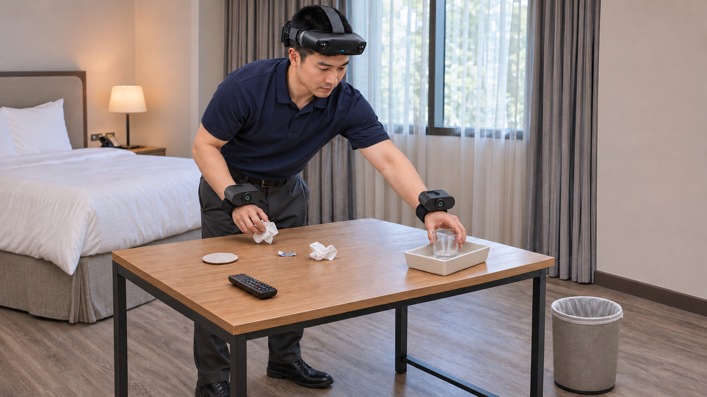

*图 1｜酒店桌面整理。人物佩戴外观参考 Ego-Mate-Ultra 与 Ego-Mate-Wristcam。AI 生成的写实场景示意，不作为实采证据或设备尺寸依据。*

下面从这段操作出发，说明第一人称视觉数据录下来之后，还要做哪些工作才能被使用、检验和追溯。本文先分析任务对观测的要求，再介绍已适配的头环与腕部设备，并结合样例标定建立空间与时间约定。全文只讨论视觉与视觉惯性观测，手部姿态估计和人到机器人的动作映射不在本文范围内。

<!-- page -->

## 01 为什么第一人称数据需要工程设计

头部视角能看到桌面、托盘和垃圾桶之间的整体关系，腕部视角离手与物体的接触位置更近。两者互相补充，但都有看不全的时候：转头时水杯可能离开头环中央视野；抓杯时手指遮住杯口；手腕翻转后，腕部相机可能只看见桌面一角。


*图 2｜同一场景中的手部、物体、局部遮挡与头腕视野。彩色区域只用于说明观测关系，不是从照片反求的相机参数，也不代表精确 FOV。*

| 场景中的变化 | 数据面临的问题 | 对应的工程要求 |
|---|---|---|
| 俯身找物、转头观察 | 运动模糊、目标离开视野 | 关注曝光与成像模式，验证覆盖和连续跟踪 |
| 水杯放回托盘 | 透明材质、反光、接触边界不清 | 保留原始图与无效标记，分区域评估深度 |
| 纸巾被抓起 | 手物遮挡、细节与形变 | 组合头腕视角，统计操作区实际可见性 |
| 垃圾移向桶口 | 多设备相对运动、帧间时差 | 软同步配对，保留时间差与动态相对位姿 |

所以采集方案要围绕任务来设计，回答这几个问题：镜头是否覆盖操作区，近场物体是否有足够细节，设备是否妨碍动作，时间偏差是否会破坏跨视角对应。多装相机只是增加潜在观测，实际可用的覆盖还取决于佩戴、遮挡、曝光、同步和几何处理。

我们把具身智能的数据壁垒归为三项：设备产能支撑持续采集，真值产线把观测转化为可用于训练的真值，场景产能提供任务与环境的覆盖。data scaling 需要三者同时到位，数据规模增长时，质量和场景覆盖才跟得上。

本文讨论设备产能，即我们已支持的头环与腕部观测设备，以及配套的标定、同步和数据处理。它们给后续真值产线提供时空关系明确的观测输入；随数据保存的标定与元数据，则建立起数据、设备和传感器参数之间的血缘关系。

<!-- page -->

## 星河数采无本体设备产能

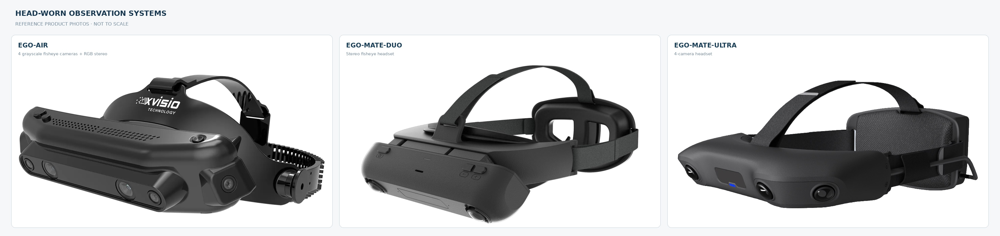

*图 3｜从左至右为 Ego-Air、Ego-Mate-Duo、Ego-Mate-Ultra，非等比例展示。Ultra 图片做了水平镜像以统一朝向，不能据此判断实际左右结构或传感器位置。*

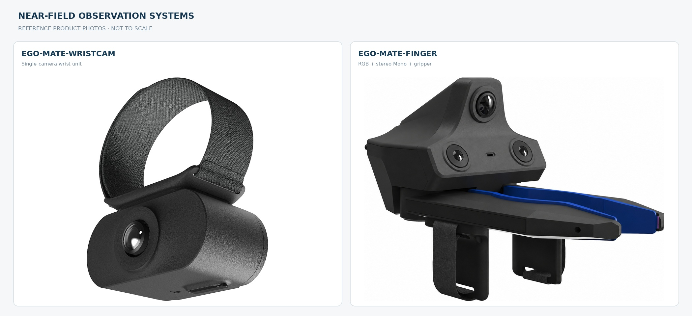

*图 4｜Ego-Mate-Wristcam 与 Ego-Mate-Finger。两者的佩戴方式与操作形式不同，应按任务选择。*

我们已支持三款头环和两款腕部观测设备。头环记录场景上下文，腕部设备补充近场手物交互。选型要同时考虑任务覆盖、成像质量和佩戴负担。

### 2.1 头环观测设备

| 候选传感器／模组 | 分辨率与帧率模式 | 快门与读出 | 镜头／有效 FOV | 同步能力 | 系统约束 | 选用或排除原因 |
|---|---|---|---|---|---|---|
| Ego-Air；4 路灰度鱼眼＋RGB 双目，共 6 路相机 | 灰度各 640×480、30 fps；RGB 各 1600×1200、60 fps | 全局快门 | 鱼眼对角 ≥160°；RGB H159°／V95° | 相机组硬同步，见 3.2 | IMU 500 Hz；USB 3.0、Wi-Fi 6；最大功耗 4 W | 更多灰度相机辅助空间定位；板载算力充足，可在线运行定位与手部出画检测 |
| Ego-Mate-Duo；双目鱼眼，标称基线 120 mm | 1600×1200、30 fps | 全局快门 | 单路 H165°／V130° | 硬同步，见 3.2 | IMU 400／1000 Hz；约 250 g、<2 W；USB 2.0、TF 卡 | 三款头环中单价最低，性价比高 |
| Ego-Mate-Ultra；前向双目＋侧向相机，前向基线 100 mm | 1600×1200、30／60 fps；其他模式见附录 | 全局快门 | 此模式单路 H165°／V130°；标称拼接 H281° | 四目硬同步，见 3.2 | IMU 400／800／1000 Hz；相机 <420 g、<6 W；USB 3.0、主动散热 | RGB 组合视场大，与腕部图像的视场重叠范围更大，有利于腕部定位 |

### 2.2 腕部观测设备

| 候选传感器／模组 | 分辨率与帧率模式 | 快门与读出 | 镜头／有效 FOV | 同步能力 | 系统约束 | 选用或排除原因 |
|---|---|---|---|---|---|---|
| Ego-Mate-Wristcam；每侧独立单目鱼眼 | 1600×1200、30／60 fps | 全局快门 | H165°／V130° | 单目；跨设备软同步，见 3.2 | IMU 400／1000 Hz；单设备约 75 g、<2 W；USB 2.0、TF 卡 | 轻量腕戴，补充自然徒手操作的近场观测 |
| Ego-Mate-Finger；RGB＋Mono 双目，基线 50 mm，带夹持机构 | RGB 1600×1200；Mono 各 1280×960；30／60 fps | 全局快门 | RGB H165°／V128°；Mono H137°／V100° | 设备内相机硬同步，见 3.2 | IMU 400／800／1600 Hz；单设备约 320 g、典型 <3 W；USB 3.0、TF 卡 | 手持／夹持任务中的彩色与双目几何观测 |

### 2.3 围绕任务选择设备组合

头环可以按在线处理需求、部署成本和跨设备共同视野来选，再通过试采，结合操作距离、遮挡和跟踪连续性，检查所选设备能否覆盖关键动作。

自然徒手示范可以用轻量的 Wristcam。允许夹持工具、需要近场双目观测的任务可以评估 Finger，但要考虑它的重量和夹持机构对动作的影响。头环与腕部各自独立运动，两者的关联要靠共同视野、时间对齐和后续定位来建立。

验收时还要在实际室内光照和动作速度下检查细节、模糊、噪声和过曝。全局快门消除不了曝光期间的运动模糊；分辨率和帧率越高，带宽、存储、功耗与散热的负担也越重。选定的组合要能持续覆盖关键操作，同时尽量少干扰采集人员的动作。

<!-- page -->

## 03 建立可信的空间与时间坐标

头环看见水杯、腕部看见抓握位置，这两张图还不能直接合在一起用。要先回答几个问题：每个像素对应哪一条空间射线，两个画面记录的是不是同一次接触，相机位姿是相对头环、腕部还是共同地图表达的。投影模型、坐标变换和时间语义都定义清楚之后，多路视频才能用于计算。

本章使用四组现有样例：Ego-Air、Ego-Mate-Duo＋双侧 Wristcam、Ego-Mate-Duo＋双侧 Finger，以及 Ego-Mate-Ultra。文中分开写三类内容：标定文件里已有的参数，由这些参数算出的结果，以及投产前还要验证的条件。有标定文件，不代表已经通过精度验收。

### 3.1 相机模型、内参与外参

#### 3.1.1 常用模型及其选用依据

工程上常把非线性成像统称为“畸变”，其实它包括两类：针孔投影之后的径向／切向修正，以及直接改变投影几何的鱼眼模型。一个相机模型要同时定义三维点到像素的投影 `π()` 和像素到单位视线的反投影 `π⁻¹()`；FOV 计算、极线校正和 VIO／SLAM 都要用到反投影。

| 模型 | 参数与建模方式 | 适用场景 | 选用依据与注意事项 |
|---|---|---|---|
| 理想针孔 Pinhole | fx, fy, cx, cy；按 X/Z, Y/Z 投影，不含畸变项 | 畸变可忽略的成像，或已去畸变／校正的虚拟相机 | 接口简单，但不能直接代替原始鱼眼模型；校正图必须关联新内参、输出尺寸和有效区域 |
| Radtan／Brown–Conrady | 针孔归一化后施加径向与切向修正；常见参数含 k1, k2, p1, p2, k3，另有有理式等扩展 | 常规镜头、中等广角、工业视觉及依赖成熟针孔接口的双目链路 | 工具支持广；超广角边缘可能拟合不稳。四参数、五参数和八参数有理式是不同配置，系数不能随意截断 |
| Equidistant／Kannala–Brandt（常见 KB4） | 围绕入射角建模；θd = θ(1+k1θ²+k2θ⁴+k3θ⁶+k4θ⁸) | 鱼眼相机、环视、机器人 VIO／SLAM | 适合强径向非线性；反投影通常需要数值求逆，要检查多项式单调区间和库的有效域；KB、fisheye 标签相同，实现未必相同 |
| EUCM | fx, fy, cx, cy, α, β；通过扩展统一投影几何表达大视场 | 大视场机器人视觉、需要高频像素—射线转换的定位系统 | 参数紧凑、反投影有闭式形式；要检查参数及根号的定义域，明显非对称的畸变仍可能残留 |
| Double Sphere（DS） | fx, fy, cx, cy, ξ, α；双球几何投影 | 超广角、多鱼眼 VIO／SLAM | 投影与闭式反投影便于实时计算；仍需验证边缘拟合、有效域和下游库支持，不能直接套用其他模型的参数 |

模型说明参考[相机内参与畸变模型说明](../../calibration/docs/02_camera_intrinsics_and_distortion_models.md)。

选模型时，先保留随数据提供的模型和完整参数，再确认下游实现的数学定义与之相同。确实需要换模型时，用覆盖中心和边缘的射线对应重新拟合，并在独立观测上验证；只改模型名或照搬同名系数是不行的。比较模型要看分区域重投影残差、独立数据上的表现、有效像素覆盖、求逆稳定性和运行成本，只看标定帧上的平均误差不够。

#### 3.1.2 样例中实际使用的模型

| 样例设备 | 文件中实际出现的模型与尺寸 | 本文采用的解释及边界 |
|---|---|---|
| Ego-Air | fisheye.json 中 4 路 SEUCM，640×480；RGB JSON 同时包含 SEUCM 与 PDCM 分支，1600×1200 | SEUCM 含 α, β，现有适配按 EUCM 公式解释；这一解释还要用图像对应验证，单凭字段不能认定与厂商定义完全等价。PDCM 包含 k3，不能不加说明地删成四参数 Radtan |
| Ego-Mate-Duo＋Wristcam | 相机 YAML 的 cameras 分支为 KB；本组头环和腕部标定均为 1600×1300；头环 IMU YAML 另含 Brown 参数 | 相机几何用相机文件中对应尺寸的 KB4；相机—IMU 外参单独读取，IMU 文件里的另一组 Brown 内参不混入 KB 图像处理 |
| Ego-Mate-Duo＋Finger | 头环 KB，1600×1200；Finger 的 cameras 分支为 KB，RGB 1600×1200、Mono 1280×960；另有 cameras_ext1 的 kb10 分支 | 按明确的分支成套使用内参、畸变与外参，不能只把 kb10 的部分系数填进 KB4。流名 IR_L/IR_R 只作为文件标识保留，不据此推断主动红外工作方式 |
| Ego-Mate-Ultra | 4 路相机均为 KB，1600×1200；本组 k5, k6, p1, p2 均为零 | 图 5 使用 cameras 分支的 KB4 原生标定，不裁剪、不缩放，也不借用规格书标称 FOV 生成视场 |

内参要按字段名读取。本次部分 IMU YAML 的 `intrinsics` 数组实际按 `cx, cy, fx, fy` 排列，不是常见的 `fx, fy, cx, cy`。Ego-Air 同时保存了 `projection_center.uc/vc` 和 `intrinsics.cx/cy`，两者数值不完全一致；接入时要明确所选投影实现用哪一组，并保留原始字段，不能把两者都当成“中心”互相替换。

#### 3.1.3 用同一种变换约定连接相机与 IMU

本文统一约定 `T_A_B` 将 B 系的点变换到 A 系，长度单位为米：

`p_A = R_A_B · p_B + t_A_B`

相机坐标采用右手系的 OpenCV 约定：X 向右、Y 向下、Z 向前。IMU 保留输入的坐标定义，不默认等于世界坐标或佩戴后的水平坐标。相机光心在 IMU 系中的位置为 `t_I_C`，光轴方向为 `R_I_C · [0,0,1]ᵀ`。外参矩阵中的平移，只有在变换方向明确后，才能解释为某个坐标系中的光心位置。

Ego-Mate-Ultra 沿用样例配套的转换约定：相机文件的外参解释为 `T_Cj_C0`，IMU 文件的 `T_cam_imu` 解释为 `T_C0_I`。两份文件中的平移都先从毫米换算成米，再组合求逆：

`T_I_Cj = (T_Cj_C0 · T_C0_I)⁻¹`

式中先变换到参考相机，再变换到目标相机，所以乘法顺序不能交换，也不能用平移取负代替完整求逆。头环与左右 Wristcam／Finger 各有独立的 IMU 坐标系，操作时彼此相对运动，因此头环与腕部之间没有固定外参，设备内的外参也不能拿来充当。

#### 3.1.4 四目布局：Ego-Mate-Ultra

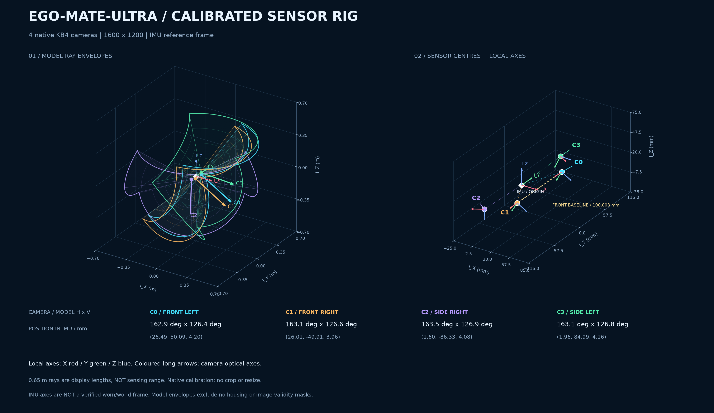

*图 5｜Ego-Mate-Ultra 样例的真实标定布局。左图以不同颜色绘制四路鱼眼的模型射线包络和光轴，右图放大 IMU 原点、相机光心及各自局部坐标轴，底部列出位置与 FOV。X／Y／Z 局部轴分别为红／绿／蓝；虚线表示几何关系，不表示设备外壳或实际支架。*

| 相机标识 | 对应观测 | 光心位置 (I_X, I_Y, I_Z)／mm | 光轴方向在 IMU 系中的单位向量 | 模型 H×V |
|---|---|---|---|---|
| C0／cam_0 | 前向左目 Color_Left | (26.493, 50.087, 4.200) | (0.861899, 0.002296, −0.507076) | 162.9°×126.4° |
| C1／cam_1 | 前向右目 Color_Right | (26.006, −49.914, 3.964) | (0.861797, −0.000821, −0.507253) | 163.1°×126.6° |
| C2／cam_2 | 右侧目 Side_Right | (1.596, −86.331, 4.079) | (0.453681, −0.734306, −0.504945) | 163.5°×126.9° |
| C3／cam_3 | 左侧目 Side_left | (1.957, 84.994, 4.156) | (0.456072, 0.735643, −0.500827) | 163.1°×126.8° |

由外参算出的前向双目光心距离为 100.003 mm。左右侧目的光心位置和光轴方向都与前向相机不同，提供的是其他方向的观测。四路相机可以对照图 3 的外观理解，但图 3 中的 Ultra 做过水平镜像，不能据此反推标定轴向。

FOV 从原始图像像素算起：把边界像素反投影为单位射线，再用 `T_I_Cj` 放入同一坐标系。表中 H／V 是经过主点的水平行／垂直列两端射线在各自扫描平面内的夹角，像素端点取 `0` 到 `W−1`、`0` 到 `H−1`；它既不是对角 FOV，也不是四路联合覆盖。图中射线统一画到 0.65 m，只是展示长度，与测距范围无关。

图中保留了相机间真实的相对倾角，但 IMU 轴与佩戴时水平、竖直方向的关系还不知道，需要在已知摆放下观测重力，或由机械安装轴来定义。部分图像角点的模型射线与光轴夹角超过 90°，这是所选模型的预测，没有扣除外壳、佩戴遮挡和无效成像区域，不能都算作已验证的可用视场。

绘图时检查了变换闭环、旋转矩阵正交性，以及每路 65×49 个采样像素的投影—反投影闭环，最大闭环误差约 `1.8×10⁻¹¹ px`。这只说明这套数学实现在数值上自洽，与真实标定的精度无关。完整矩阵、输入文件摘要与计算结果见[布局计算记录](blog_sum_assets/spatial_calibration_audit.json)，可用[绘图脚本](blog_sum_assets/build_spatial_figures.py)复现。

#### 3.1.5 双目布局：Ego-Mate-Duo

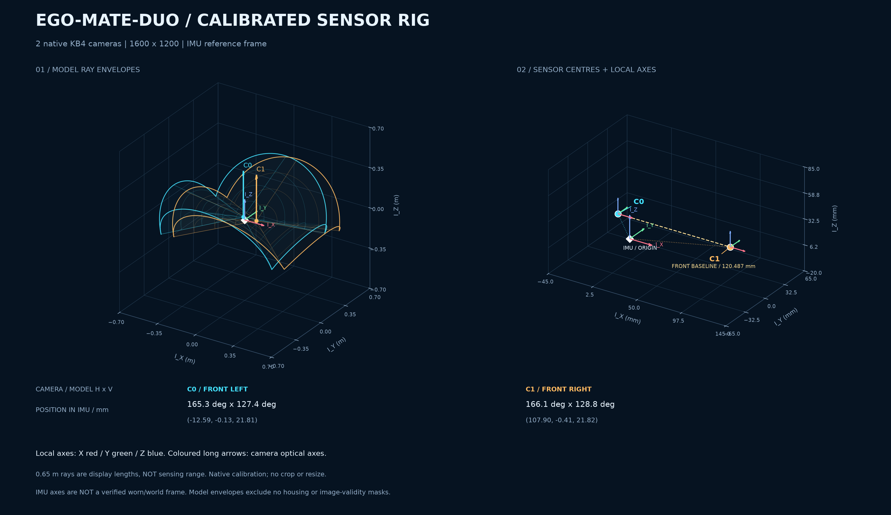

*图 6｜Ego-Mate-Duo 的真实双目标定布局。左图为左右目鱼眼射线包络和光轴，右图放大 IMU 原点、两路相机光心及局部坐标轴，虚线标示前向双目基线。*

本图用的是 Duo＋Finger 联合样例中头环的原生 1600×1200 KB4 标定，没有用较早 Wristcam 联合样例的 1600×1300 模式。计算方法与四目相同，即 `T_I_Cj = (T_Cj_C0 · T_C0_I)⁻¹`；相对位置与朝向全部来自输入外参，安装角度不从外观图推测。

| 相机标识 | 对应观测 | 光心位置 (I_X, I_Y, I_Z)／mm | 光轴方向在 IMU 系中的单位向量 | 模型 H×V |
|---|---|---|---|---|
| C0／cam_0 | 前向左目，文件标识 IR_L | (−12.587, −0.126, 21.805) | (−0.001225, 0.004639, 0.999988) | 165.3°×127.4° |
| C1／cam_1 | 前向右目，文件标识 IR_R | (107.899, −0.414, 21.817) | (−0.000028, 0.003981, 0.999992) | 166.1°×128.8° |

由外参算出的光心距离为 120.487 mm，两路光轴接近平行。双目的共同视野还取决于目标距离和遮挡，单看单路 H／V 判断不了。Duo 与 Ultra 各自沿用自己的 IMU 轴约定，所以两张图中光轴相对坐标轴的方向差异，不代表佩戴时的朝向差异。

FOV 定义、像素端点和 0.65 m 展示长度与四目图相同；图像没有裁剪或缩放，也没有扣除外壳和无效成像区域。该样例的外参旋转只保存到小数点后六位，绘图直接用原值，没有重新正交化；表中光轴方向是归一化后的结果。数值闭环检查代替不了标定精度和设备绑定的核验，本组会话标识与标定序列号的对应关系还要按 3.3.2 节确认。输入摘要、矩阵和计算结果见[双目布局计算记录](blog_sum_assets/duo_spatial_calibration_audit.json)，与四目图共用[绘图脚本](blog_sum_assets/build_spatial_figures.py)。

### 3.2 时间同步与曝光时序

#### 3.2.1 硬同步与软同步

空间标定回答光线从哪里来，时间同步回答光线在什么时候被记录。整理桌面时手和水杯一直在动，即使几何模型正确，不同时刻的两帧画面也可能对应不同的接触状态。

目前已支持设备的同步关系分为三类：

| 同步关系 | 当前方式 | 数据表达 |
|---|---|---|
| 设备内多相机 | 时间硬同步 | 同一相机组在同一快门时刻采集，同组对应帧共享时间戳；包括 Ego-Air 的鱼眼组与 RGB 双目、Duo 双目、Ultra 四目及 Finger 设备内相机组 |
| IMU 与相机 | 时间软同步 | 将 IMU 采样与相机帧对齐，保留时间映射及对齐信息 |
| 跨设备相机 | 时间软同步 | 头环与左右 Wristcam／Finger 分别采集，通过软件建立时间对应，保留原始时间、配对关系与时间差 |

例如，双目组的 `stereo_left` 与 `stereo_right` 对应帧时间戳相同。左右腕是两台独立设备，不构成固定基线的硬同步双目。同步关系和分辨率、帧率配置分开记录。

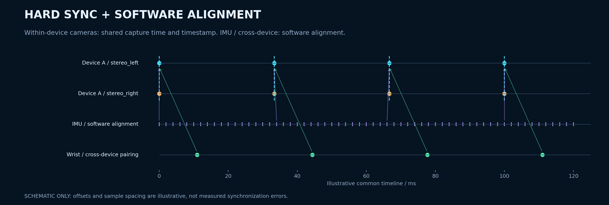

*图 7｜设备内相机对应帧共享时间戳；IMU 与相机、跨设备相机之间采用软同步，软件对齐不改变原始采样时刻。图中的时间间隔和偏移只是示意，不代表具体设备的帧率或实测同步误差。*

#### 3.2.2 时间戳的语义

一个时间戳要配上时钟域、单位和时间原点，并说明它表示曝光开始、曝光中点还是主机接收时刻。单位相同的两个时间戳可能来自不同时钟；文件夹日期和视频播放时间也代替不了传感器采样时间。

现有样例里既有微秒也有纳秒记录，部分导出 PTS 逐帧存在差异。接入时要区分原始采集时间、导出时间和处理后的对齐时间，并保留三者的关联；帧组不能只按文件名或行号认定。导出时间差在核实之前不能当作曝光同步误差，文件名相同、帧数相同也证明不了物理时刻一致。

全局快门消除的是逐行成像的时间差，曝光仍有时长，不同设备也不会因此同时曝光。以后接入滚动快门设备时，还要记录读出方向和行延迟，把帧级时间对应和行级成像时刻分开。

#### 3.2.3 软同步做了什么

离线软同步在时间可比较的前提下，给不同相机配上时间最接近的图像。当前处理保留输入时间戳和配对时间差，重新组织后的数据仍能追溯到各路原始记录。软同步只改变观测之间的配对关系：不同时刻拍下的画面不会因此变成同时曝光，缺失的观测也补不回来。

时间对应够不够好，取决于任务。静态桌面和快速抓握对时差的敏感程度不同；验收时要结合配对时间差分布、有效配对比例、时间覆盖缺口和动态手物上的表现，判断数据能否用于跨视角匹配、深度估计或接触分析。超出要求或缺少对应观测的片段要明确标记，不能为了让序列看起来连续而硬配。

图像配对完成后，时钟校正和相机—IMU 对齐仍是另外的工作：不同时间原点、长期漂移和视觉惯性时间偏移要单独确认，标定文件里的时间偏移也不能直接当作实际同步残差。交付时除了对齐后的文件，还要附上时间来源、配对关系和适用范围，后续算法才能判断哪些观测可以一起用。

### 3.3 出厂标定、投产前验证与数据—设备追溯

#### 3.3.1 出厂参数与投产前验证

处理输入是随会话保存的出厂内外参。我们先核对设备标识、相机模型、图像模式、单位和变换方向，再处理有代表性的试采片段。元数据里的标定日期、标定板类型、环境温度可以作为来源信息，但凭这些既还原不出厂商未披露的标定流程，也判断不了精度是否满足任务。

投产前的反向验证固定输入标定，逐层检查：

| 验证层次 | 检查方法 | 需要记录的证据与限制 |
|---|---|---|
| 单设备成像与几何 | 去畸变、极线校正、独立对应点及视差／深度结构 | 按中心／边缘和距离区间统计残差与有效覆盖；模糊、纹理、遮挡和同步都会影响结果 |
| 多视角重叠与跨设备关联 | 全景融合前的重叠区对应、头环—腕部特征匹配 | 记录几何筛选、内点分布、配对时差与失败片段；最终融合图看起来自然，不能说明标定准确 |
| 连续运动与统一空间 | 单设备定位、头环建图及腕部在共同地图中的定位 | 记录跟踪连续性、定位有效率与独立观测残差；地图定位结果是系统一致性的证据，不是独立的绝对真值 |

如果另外做了标定优化，出厂参数的结果和优化后的结果要分开保存。绝对深度或位姿精度需要独立测距、参考轨迹等额外证据，布局图和投影闭环检查代替不了。本章只做了文件核对和几何可视化，任务验收结果还没有统计。

#### 3.3.2 从帧追溯到会话、传感器与标定快照

Ego-Air 的元数据通过 `files.calibration` 关联各路 JSON，并记录 `episode_id`、设备标识和流配置；Duo＋Wristcam 的联合元数据含 `session` 与 `devices[]`，各设备分别指向自己的相机、IMU 标定；Duo＋Finger 与 Ultra 样例也保存了相应的设备元数据、传感器记录和标定文件。据此可以建立以下关联：

```
原始帧／IMU 采样
  → 采集会话＋设备标识＋传感器流＋原始时间
  → 会话关联的相机／IMU 标定快照＋采集模式
  → 时间映射＋空间约定＋处理配置与软件版本
  → 校正图／深度／位姿等派生结果
```

有这些字段，关联也未必正确。本次 Duo＋Finger 联合样例中，头环元数据里的设备标识与相机标定内部序列号不一致，正式使用前要确认这是模组级标识还是绑定错误；Duo＋Wristcam 联合元数据顶层的 `video_right` 实际指向右腕文件，不是头环右目。接入层要按设备清单和实际文件核对每路流的归属，不能凭顶层键名猜。

| 追溯对象 | 样例已有信息 | 正式交付仍需明确或补齐 |
|---|---|---|
| 会话与设备 | 会话／episode 标识、设备标识、部分固件与采集软件版本 | 设备与模组标识的绑定规则、工作模式一致性及异常处置 |
| 传感器与原始数据 | 流配置、视频／采样文件、PTS 或时间字段 | 帧组关系、时钟域与曝光语义、缺失记录及文件摘要 |
| 标定与适配 | 随会话保存的 JSON／YAML、模型、内外参及部分时间偏移 | 精确绑定到流和分辨率、模型分支、单位转换及解析器版本 |
| 派生结果 | 本章图示的输入摘要、变换矩阵与计算记录 | 对完整处理链路保存输入摘要、同步映射、配置、软件版本和质量状态 |

标定随采集数据一起落盘，后续处理关联的是该会话实际使用的标定快照；设备当前目录里的参数可能已被新标定覆盖，不能拿来代替。本章绘图为输入标定记录了 SHA-256，复现时可以确认读取的是同一份文件。目前还不是所有采集与交付环节都自动记录摘要并做质量门控。

如果要进一步验证长期稳定性，可以在开机初期与持续运行后、反复佩戴前后，用同一份出厂参数复测受控场景，比较分区域几何残差和有效覆盖。复测时设备整体可能移动，要重新估计目标相对设备的位姿，并先排除模糊、曝光和匹配变化，再判断参数是否仍然适用。这一项是后续验证建议，尚未实施。

---

## 第四章：从图像处理到空间定位，验证数据是否适用

第三章定义了空间与时间约定。本章检查这些图像、IMU 和标定放进实际算法后能否一起工作。

本章用三组结果逐层检查：双目能否建立深度关系，多目能否形成连贯视野，连续运动中的头环与腕部能否进入同一空间。三组结果检验的是数据和处理链路合在一起是否适用，不能逐项证明每个传感器、每组标定参数都准确。

| 验证链路 | 本章真实材料 | 重点检查 |
|---|---|---|
| 双目校正 → 视差 → 公制深度 | Ego-Air RGB 双目的同帧图像与深度数组 | 像素对应、纵向残差、深度尺度及无效区域 |
| 多路视角 → 柱面全景 | 多目头环的连续拼接视频 | 重叠区域、接缝、近场视差与运动中的稳定性 |
| 各设备 VIO → 跨设备定位 → 共同坐标系 | Ego-Mate-Duo＋双 Wristcam 的定位回放与后端统计 | 图像／IMU 的连续可用性、共同观测及动态相对位姿 |

### 4.1 双目：从水平对应到视差与深度

#### 4.1.1 极线校正与纵向残差

本例取自 Ego-Air 会话 `episode_20260710_152807`，用的是 RGB 双目，不是用于 SLAM 的四路灰度鱼眼。导出、校正和深度推理都沿用已有结果，本文只加了水平辅助线、深度显示和检查统计，没有重新拟合标定，也没有为减小残差再变换图像。

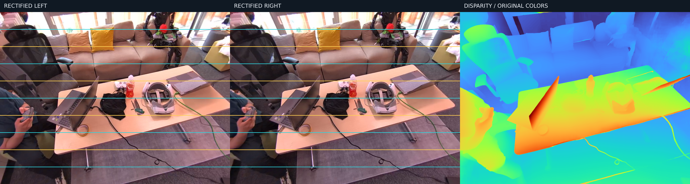

*图 8｜左、中两幅 RGB 图各为 1600×1200，彩色辅助线画在相同像素行上；右侧是未改动的原视差可视化。辅助线只画在前两幅图上，原始素材另有保留。*

理想的水平立体校正让静态场景中同一个空间点落在左右图的同一行，匹配只需沿水平方向搜索。检查时要比较同一个物体特征在左右图中的高度。桌沿是否水平说明不了问题：透视会让桌沿倾斜，这不代表校正失败。

辅助线之外还需要独立的图像对应检查。我们在这对校正图上提取 SIFT 特征（每幅最多 3000 个），用双向最近邻比值筛选（阈值 0.7），既不按纵向误差剔除匹配，也不重新估计几何模型，得到 689 对候选对应点。它们的绝对纵向差中位数约 3.8 px，P95 约 8.4 px。候选中可能有误匹配，这些数字不能当作标定误差的真值，但足以说明：单凭三联图，不能宣称已经达到亚像素极线对齐。

下一步要把检查扩展到更多帧，按视场中心／边缘、距离和运动状态分组，复核对应点和时间关系，再判断残差来自匹配、模型适配、标定还是采样时差。在此之前，这里的纵向残差仍是一个未解决的几何问题。

#### 4.1.2 视差、深度与公制尺度

视差图表示左右图之间的像素位移，深度图表示三维距离，两者都用伪彩色显示，含义并不相同。在校正后两目焦距与主点相同、水平视差取 `d = u_left − u_right` 的条件下：

```
Z = f · B / d

f：校正后的水平焦距，单位 px
B：双目基线，单位 m
d：校正后图像上的视差，单位 px
Z：沿校正后左相机光轴的深度，单位 m
```

这里的 `Z` 是沿光轴的深度，不是到光心的欧氏距离。如果推理前缩放过图像，焦距和视差要用同一分辨率下的数值，不能混用原图参数。

该样例保存的校正参数为 f≈817.657 px、B≈0.065216 m，即 `fB≈53.3243 m·px`。同一时间戳下的视差数组和米制深度数组，在正值有限区域满足上式；毫米 PNG 与米制数组在量化误差内一致。这说明输出的尺度和单位内部一致，测距精度要另外验证。

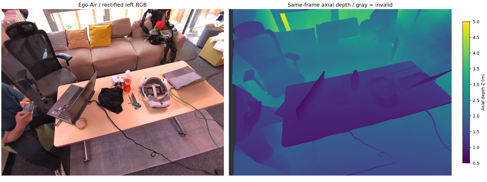

*图 9｜左为同帧校正 RGB，右为由米制深度数组重新着色的结果。色条固定为 0.5–5.0 m，灰色表示非正值或非有限值区域；这个显示区间不代表设备量程或精度保证。*

这帧深度数组中正值有限的像素约占 97.56%，数值大致在 0.68–4.94 m。这个比例只说明该帧哪些像素有数值，不是可靠深度的比例；玻璃、反光瓶身、细线、遮挡边界等位置是否估准，还不知道。深度是用同一套视差和校正参数算出来的，不能反过来独立证明标定正确。

验收时，除了看桌面、设备与背景的远近层次，还要统计遮挡和边界附近的异常、跨帧稳定性，以及在有独立测距参考时按距离分段的误差。远处视差小，深度误差更容易被放大，近场的结果不能直接推广到整个空间。现有材料没有关联可核验的深度推理模型和权重版本，需要补进运行记录；模型不能从输出文件名推断。

### 4.2 多目：用全景检查重叠视野

双目检查同一物体的左右对应，多目还要检查不同朝向的视角能否连成可用的观测范围。本例来自一台独立四目头环的 `Task0006` 测试数据，原图为 1200×1600（宽×高），图像模式与前文其他四目设备不同。拼接顺序是 `cam3 → cam1 ← cam0`，以 `cam1` 为参考。`cam2` 与 `cam1` 朝向接近，这次扩展视野的展示没有用它，这不影响它在双目深度等任务中的用途。

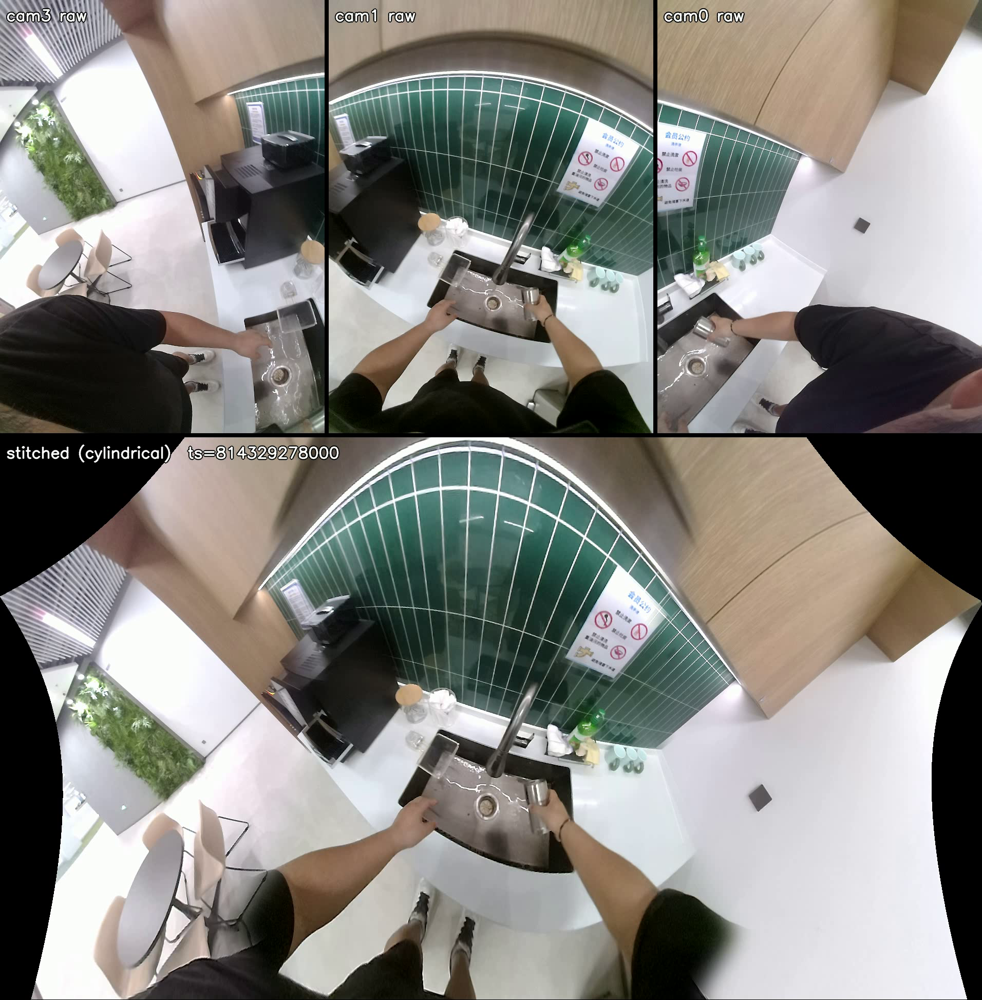

*图 10｜拼接视频第 12 秒。上方从左到右为参与拼接的 `cam3`、`cam1`、`cam0` 三路原图，下方为柱面全景。这是四目设备的三路拼接示例，不是四路同时输出，也不能证明 360° 覆盖。黑边是当前输出中没有有效图像覆盖的区域。*

[播放多目柱面全景视频（约 39 秒）](blog_sum_assets/grid_cyl.mp4)

#### 4.2.1 实际链路：标定去畸变，特征估计对齐，固定映射拼接

这套实现没有直接用标定外参把图像投到一起，而是把成像模型、特征对齐和显示投影分开处理：

```
三路同名时间戳图像，共 1181 组
  → 按样例提供的 KB4 模型生成去畸变视图
  → 在朝向重叠区的虚拟视图中提取、匹配 SIFT，再映回统一虚拟像面
  → 跨时间汇总对应点：本质矩阵 E 筛选＋每对相机拟合一个单应矩阵 H
  → 用整段固定的 H 映射到柱面，确定接缝归属并融合
```

按同名时间戳分组只是输入规则，本身证明不了曝光同步。拟合阶段共抽取 60 个时刻，48 个用于估计，12 个留作检查；统一虚拟像面为 1200×1600，水平视角 120°，焦距约 346.4 px。匹配时把虚拟视角转向重叠区，并屏蔽图像底部的人体区域，以减少大视角差和自身遮挡对匹配的干扰。

先用本质矩阵筛出符合固定双目几何的候选对应点，再用 LMEDS 为每对相机拟合一个整段共用的 `H`。`H` 不由相机间标定外参生成；外参只在事后用来和特征恢复的相对姿态做比较。渲染时把柱面到虚拟像面、再到原始鱼眼图的映射合并起来，每路每帧只做一次重采样，避免先去畸变存图、再拼接带来的二次插值。

接缝默认优先保留参考相机的内部区域，其余位置按到有效图像边界的距离分配，用羽化过渡；实现里也有硬切和多频段融合选项。`H` 不逐帧重估，也不用局部非刚性形变去消除重影，所以融合只能让接缝看起来柔和，近场视差仍然存在。

默认柱面模式用整段序列的平均加速度方向，经 IMU—相机旋转变换后定出固定柱轴。IMU 在这里只决定显示方向，不参与 `H` 的估计，也不做逐帧姿态稳定或视觉惯性定位，头部运动时画面仍可能倾斜。代码默认的 320° 是裁剪前画布的角度范围，不是实测有效 FOV，也不是 360° 全覆盖。

#### 4.2.2 单应对齐残差

现存拟合记录里有融合前的检查。下表是 12 个留出时刻的候选对应点经训练阶段估计的 `E` 筛选后，固定 `H` 的对齐残差：

| 相机对 | 留出对应点数 | H 对齐残差中位数／px | H 对齐残差 P90／px |
|---|---|---|---|
| cam3 → cam1 | 347 | 12.7 | 60.5 |
| cam0 → cam1 | 569 | 10.1 | 22.9 |

像素单位属于上述统一虚拟像面，与原始鱼眼像面和最终全景无关。统计包含所有通过 `E` 筛选的留出对应点，没有再按 `H` 残差去掉较差的点。留出数据没参与 `E`、`H` 的拟合，但经过了已估计 `E` 的筛选，所以这不是全部匹配的统计，也不是独立真值。

记录显示，特征恢复的相对旋转与标定外参分别相差约 0.33° 和 0.36°。这是同一成像模型下姿态一致性的参考，不能换算成逐像素的标定精度，也没有检验平移尺度。由标定算出两侧相机到参考相机的基线约为 15.2 cm 和 9.8 cm。近场、非共面的操作场景里，一个 `H` 只能在几个深度之间折中：以 0.5 m 处的目标估算量级，`fB/Z` 可达约一百像素，一组固定单应不可能同时对齐背景和近处的手与物体。

所以较大的 `H` 残差不能直接记作“标定误差几十像素”，也不能全部算在视差头上而忽略误匹配、同步和模型问题。它首先反映的是固定单应表达不了三维近场场景，验收还要按内容和距离分组检查。

这组场景同时有背景瓷砖、近处水池、双手、金属杯和反光水面，可以把不同问题分开看：

- 背景结构与重叠区域：沿瓷砖缝、台面边缘等结构看相邻视角的衔接，检查是否有折线、错位或重影。这些比颜色过渡是否柔和更能暴露几何问题。柱面图中的直线不一定保持为直线。
- 近场手物与动态遮挡：各相机光心不重合，同一近处物体会产生视差。即使相机参数正确，按背景对齐的关系也未必能同时对齐近处的手臂和杯子；运动、时差和遮挡还会造成接缝跳动或局部重复。
- 连续运动与有效覆盖：要看完整视频，不能只挑一帧平滑的全景。观察接缝是否随转头和伸手移动，目标跨视角时是否断开，哪些区域始终没有覆盖。

全景可以验证多路观测能否一起投影和融合，但证明不了每一项标定的精度。本例的对齐关系来自图像拟合，拼接看起来自然，也说明不了原始外参准确。正式验收要同时保留融合前的对应点和残差、失败片段，以及实际使用的标定和渲染配置。本例的结论不专门针对 Ego-Mate-Ultra。

链路描述依据[实现代码](../headring_panorama/panorama_stitch.py)和[实现说明](../headring_panorama/imp_details.md)，数值取自[现存拟合记录](../headring_panorama/output/homographies.json)，记录中的采样时间戳属于 `Task0006`。文中所附视频与工程根目录的视频文件相同，但和当前输出目录中的视频不是同一个文件；拟合记录也没有完整保存柱面、融合等渲染参数。因此，表中的统计和视频的外观要分开看，两者不构成一次配置完整绑定的精度验收。

### 4.3 连续运动：将单设备与跨设备定位放在同一条链路中

#### 4.3.1 从单设备 VIO 到共同空间

静态图像上几何关系成立，设备在快速转头、伸手或被遮挡时未必还能持续定位。本例使用 Ego-Mate-Duo＋左右 Ego-Mate-Wristcam，原始会话为 `EGO_AZEB761000F_Joint_2_20260831_102919`，依次看同相机跨帧匹配、头环与腕部匹配、地图点跨关键帧回投、双腕与头环地图的关联，以及共同空间中的连续轨迹。这些结果来自同一采集会话，但处理版本和统计范围各不相同，下文分别说明，不合并成一次验收。

实际链路可以概括为：

```
头环与左右腕部各自的连续图像＋IMU
  → 各设备本地视觉惯性里程计（VIO）
  → 头环关键帧与三维地图点
  → 腕部图像与头环地图建立 2D–3D 对应
  → 跨设备位姿约束＋各自里程计约束
  → 同一地图坐标系下的头环与双腕轨迹
```

单设备 VIO 是这条链路的基础：图像提供场景约束，IMU 提供连续运动信息，相机—IMU 外参和时间关系决定两类观测能否正确关联。后文位姿图回放对应的头环运行日志记录了 30,400 个 IMU 采样和 886 组同步相机帧，说明前端确实读入了惯性数据，轨迹不是只靠图像得到的。不过，读入数据并输出位姿，不等于 IMU 噪声、偏置和时间偏移各自通过了独立验收。

先看同一相机能否在不同帧之间找到共同观测。图 11 的左右两幅图像都来自头环 `head cam0`，展示的是跨时刻的特征对应，不是左右目立体匹配。它检查运动中能否重新认出场景结构；连线是否水平，与双目极线校正、曝光同步无关。

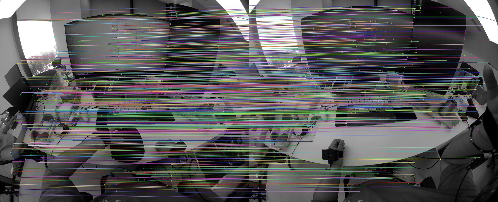

*图 11｜同相机跨帧匹配。左右面板是 head cam0 的两张图像，彩色连线是展示的候选对应。素材没有给出配对帧号、时间差或几何内点标记，因此不据此计算跟踪成功率，也不把全部连线当作已验证的内点。*

跨设备关联要解决另一个问题：各设备独立运行，本地轨迹不能因为坐标轴名称相同就直接叠加。这里用腕部和头环对静态共同场景的观测做地图定位，再把这些约束和各自的 VIO 里程计一起优化。头环与腕部相对运动，两者之间的位姿随时间变化，不是固定外参。

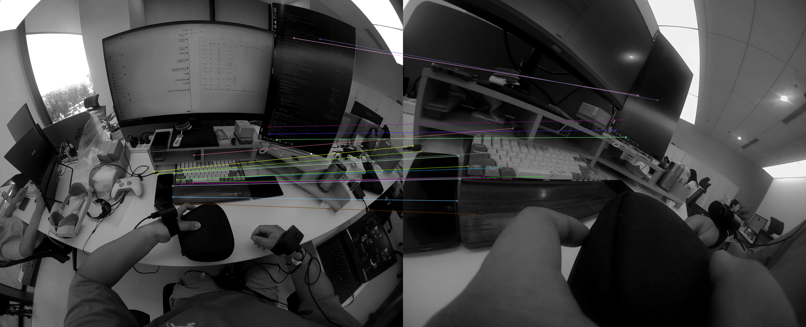

*图 12｜头环与左腕的跨设备匹配。两路图像在视角、尺度和遮挡上差别明显，但仍能看到共同场景中的候选对应。这只是 2D–2D 关联示例；要形成腕部相对头环地图的位姿约束，还要关联头环三维地图点并通过几何检验。这张图不能用来宣称定位成功或给出精度。*

跨设备匹配要特别检查：对应点是否落在相对静态的共同背景上，是否覆盖足够的像面，是否集中在重复纹理上。手和被操作物体会动，即使同时出现在两路图像里，也不能当作静态地图约束。匹配图说明关联有可能建立，哪些查询最终被接受，要看地图定位记录。

#### 4.3.2 地图点跨关键帧回投

有了匹配，几何关系也未必正确。进一步的检查是：把较早关键帧估计出的三维地图点，用后续关键帧的位姿和相机模型重新投到图像上，比较预测位置和实际观测位置。本文把这一步称为地图点回投（重投影），它与从单个像素反投影得到深度是两回事。

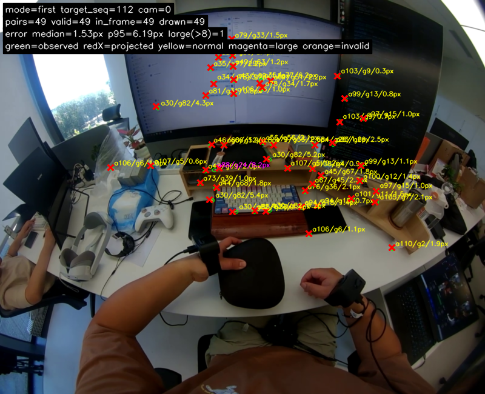

*图 13｜head cam0，目标关键帧序列号 112，`mode=first`。绿色圆圈是实际二维观测，红色叉号是冻结地图点的预测投影；黄色连接线表示误差不超过显示阈值 8 px，紫色表示超过阈值，橙色用于标记无法有效投影的观测。标签中的 `a` 是地图点的锚定序列号，`g` 是锚定与目标之间的序列号差。*

该图由[跨关键帧回投脚本](../../open_vins/ov_offline_test/scripts/show_cross_keyframe_reprojects.sh)导出，使用同一原始会话下的 `cross_pose_new` 结果。根据[投影实现](../../open_vins/ov_offline_test/python/cross_keyframe_reprojection.py)和保存的残差记录，`first` 模式对每个特征冻结它第一次持久化的 SLAM 三维点估计，再投到之后仍观测到该特征的关键帧，不同点的锚定关键帧可以不同。`final` 模式则冻结最后一次保存的点估计，向较早的关键帧回投。图中只有 `first`，不能据此说最终地图的残差有所改善。

沿用第三章的变换约定，令 `M` 为该头环会话的本地地图系、`B` 为设备机体系、`C` 为 cam0，这一检查可写为：

```
p_C(t) = T_C_B · T_M_B(t)⁻¹ · P_M
u_predicted = π_C(p_C(t))
error_px = ‖u_predicted − u_observed‖₂
```

其中 `P_M` 是冻结的地图点，`π_C` 使用该会话保存的相机内参与畸变模型。残差同时受地图点、目标位姿、相机模型和外参影响，不能全部解释为某一项标定误差。

本图有 49 条跨关键帧观测记录，全部能有效投影、落在图内并已绘出。二维欧氏重投影误差中位数为 1.53 px，P95 为 6.19 px，超过 8 px 的有 1 条。数值与该帧 CSV 一致，单位是本次会话 800×650 投影图像上的像素，不能和其他分辨率下的像素误差直接比较。8 px 只是这次导出的可视化分界，不是项目验收阈值。49 条也只是这一目标关键帧上的记录，不代表整张图的所有特征、全部原始帧或整段会话。

冻结地图点后跨帧核对，比只看同帧拟合更能暴露随运动累积的不一致；但地图点和位姿都来自同一条定位链路，不是独立真值。下一步要按序列跨度、像面位置和运动强度检查残差分布，并对比 `first` 和 `final`，区分点估计的变化和持续存在的几何不一致。这张图只是单设备跨关键帧一致性的证据，与跨设备定位的绝对精度无关，统计也不与后文较早那次位姿图运行混用。

#### 4.3.3 跨设备地图关联：单帧观测使用了哪些头环地图点

前面的匹配图展示两幅图像之间的对应，地图点回投检查单设备的跨帧一致性。跨设备定位还要回答：当前腕部图像中的内点关联到头环地图中的哪些三维点，这些点怎样支撑这一帧的定位。为了让图像对应和地图点逐一对照，图中只高亮左右腕各一个选中查询帧的匹配，没有叠加整段序列的累计匹配点或设备轨迹。

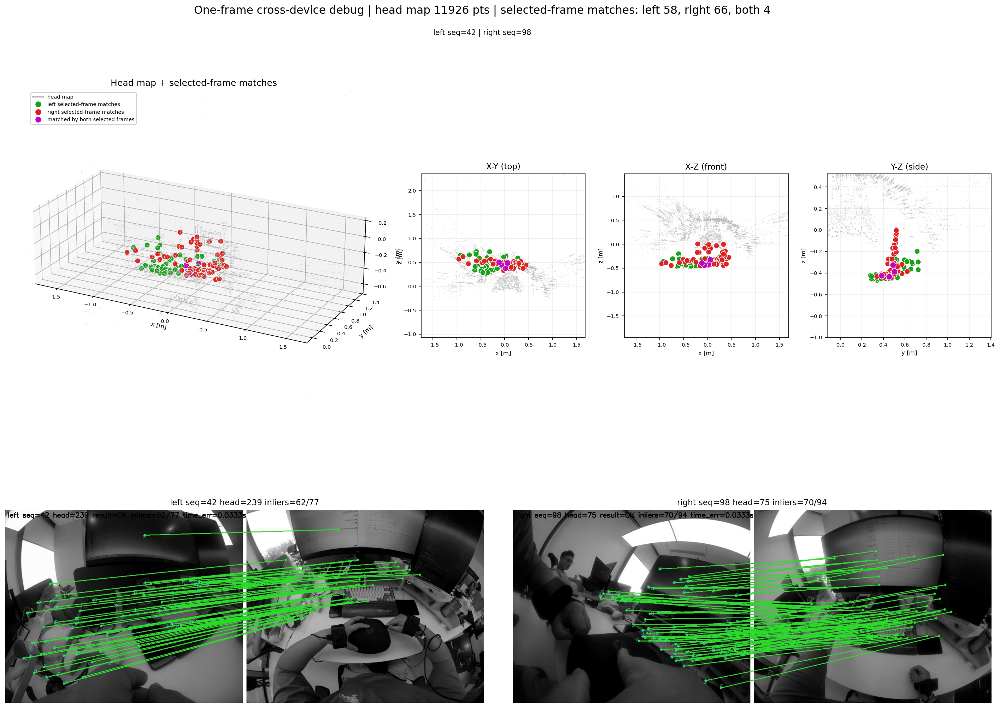

*图 14｜单帧跨设备地图关联。左上为三维视图，右上依次为 XY 俯视、XZ 正视和 YZ 侧视，坐标单位为米。灰色是头环地图；绿色、红色、紫色高亮点分别表示仅左腕选中帧匹配、仅右腕选中帧匹配，以及两个选中帧都匹配到的地图点。底部为对应的两组图像匹配：左腕查询序列号 42、右腕查询序列号 98。图中不绘制设备轨迹。*

该图由[单帧跨设备定位可视化脚本](../../open_vins/ov_offline_test/python/visualize_cross_device_debug_oneframe.py)读取本会话 `cross_pose_new/debug` 下的地图、匹配记录和定位结果绘制。每个腕部只保留选中查询帧及其相机配对的记录，再取 `inlier=1` 且三维坐标有限的条目，按 `landmark_id` 去重。上方高亮点和底部的单帧图像匹配用的是同一组记录。

背景头环地图共有 11,926 个地图点。两个选中帧的高亮点分为三个互斥集合：

| 地图点分组 | 去重地图点数 | 含义 |
|---|---|---|
| 仅左腕选中帧匹配 | 58 | 左腕选中帧存在该地图点的内点匹配，右腕选中帧没有 |
| 仅右腕选中帧匹配 | 66 | 右腕选中帧存在该地图点的内点匹配，左腕选中帧没有 |
| 两个选中帧都匹配 | 4 | 同一地图点标识分别出现在两个选中帧的内点匹配记录中 |

左腕选中帧涉及 62 个去重地图点，右腕 70 个，并集 128 个；图标题中的 `left 58`、`right 66` 不含共享的 4 个点。紫色点表示两个选中帧关联到了同一个地图点，不表示双腕在同一时刻看到了它们，也不说明双腕之间有固定外参。这些数量只描述这两帧，不能外推为整段序列的地图关联覆盖率。

两个选中帧就是脚本的默认选择，即从成功查询中挑内点最多的相机配对：左腕查询序列号 42 对应头环关键帧 239，该配对 77 条匹配记录中有 62 条内点；右腕查询序列号 98 对应头环关键帧 75，94 条中有 70 条内点。底部统计的是匹配记录条数，上方统计的是去重地图点数，这两例中内点数恰好等于去重点数。两例不是同一时刻的左右腕快照，也不是随机抽样，它们的内点比例不能当作全会话的定位成功率。图中的 `time_err` 是调试字段，也不能当作传感器曝光同步精度。

单帧视图把“这一帧匹配到多少点”展开成“哪些场景结构支撑了这一帧的定位、分布在哪里”。检查时要看高亮点是否过度集中，是否主要落在单一平面或重复纹理上，不同视图中有没有异常分离的点群；点多不代表几何约束充分。图像对应和地图点都是估计和导出的结果，不是独立的距离或位姿真值。连续运动中的轨迹放到下一节看。

图 14 与导出目录中的同名 PNG 一致，地图点分组和底部样例计数也已核对。它和前述单设备回投用的是同一个 `cross_pose_new` 结果目录，与下文较早那次位姿图回放的查询统计分开解释。

#### 4.3.4 跨设备定位回放

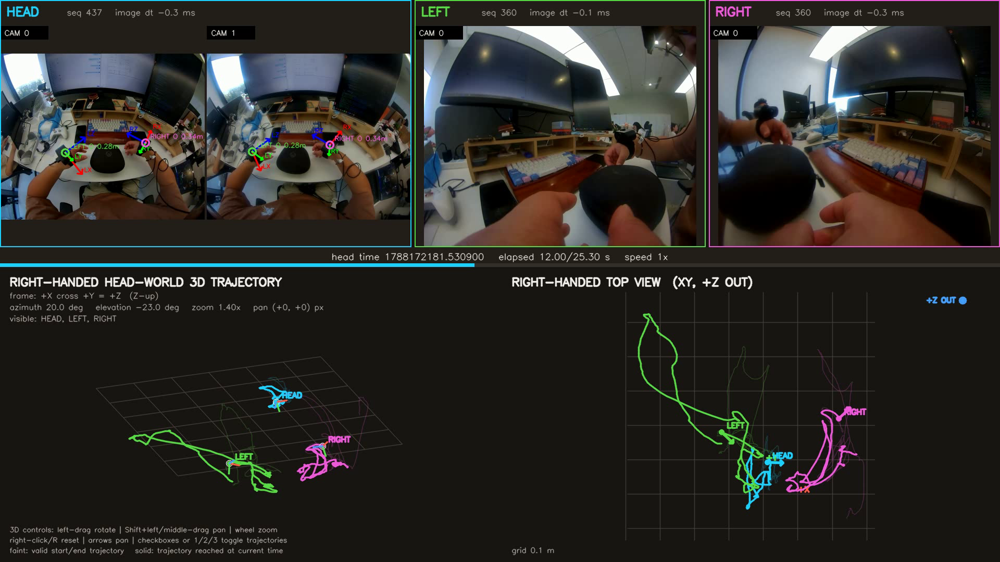

*图 15｜定位回放第 12 秒。上方为头环双目及左右腕部图像，头环图中叠加腕部位姿的投影；下方为共同坐标系中的三维轨迹与 XY 俯视，青、绿、紫分别表示头环、左腕、右腕。投影位置和距离均来自估计结果，不是独立测量。*

[播放头环＋双腕跨设备定位视频（约 25 秒）](blog_sum_assets/replay_stage_pose_graph.mp4)

该视频对应位姿图优化阶段。约束统计包括 2354 个里程计相对位姿约束、153 个左腕和 217 个右腕跨设备约束，以及一个锚定位姿先验。IMU 参与了前端 VIO，但这一后端阶段没有额外的 IMU 预积分或图像重投影因子，所以它不是完整视觉惯性联合 BA 的验证结果。

与回放对应的后端记录给出了以下查询统计：

| 腕部设备 | 尝试定位的查询关键帧 | 接受的地图定位 | 查询接受比例 |
|---|---|---|---|
| 左 Wristcam | 380 | 153 | 40.3% |
| 右 Wristcam | 380 | 217 | 57.1% |

分母是该次后端尝试定位的查询关键帧，不是全部原始图像，也不是视频播放帧。没有被接受的时刻，轨迹仍可以靠本地 VIO 约束延续，所以轨迹连续不等于每一帧都完成了跨设备重定位；回放插值补出来的画面，也不能算进成功率。

在这组数据中，独立设备之间能够建立共同场景关联，并在统一空间中表达运动；同时仍有相当一部分查询没有被接受。下一步要按共同视野、内点分布、遮挡和时间差逐类分析，失败片段也要保留。优化目标下降、轨迹变平滑，只说明约束拟合得更好、系统更一致，不能说明绝对位姿误差降到了某个数值。

沿用第三章约定，若 `M` 为地图坐标系、`H` 为头环设备坐标系、`R` 为某一腕部设备坐标系，则在共同时间 `t` 下：

```
T_H_R(t) = T_M_H(t)⁻¹ · T_M_R(t)
```

这一关系把腕部在地图中的运动换算成腕部相对头环的运动。使用前要确认时间可比较、两个位姿对应同一时刻，并且输出确实是约定的设备坐标系；相机位姿和 IMU／设备位姿不能混用。回放界面上的图像时间差，是所选图像与回放时间线的差值，既不是曝光同步精度，也不是定位精度。

本章的结论分两层：链路能运行、观测能关联，和精度已经达标，是两件事。双目结果的像素、视差和公制尺度都能追溯，但独立图像对应显示仍有纵向残差。全景有留出对应点的对齐统计，同时暴露了固定单应在近场的局限，还要补上与视频绑定的渲染配置和分场景检查。匹配图和地图点回投补充了共同观测和跨帧几何一致性的证据。定位结果确认图像和 IMU 参与了连续估计，双腕能关联到共同地图，但查询覆盖和绝对精度要分别评估。正式交付要保留失败片段，补齐模型和处理版本，并用独立测距或参考轨迹按任务阈值验收，不能把这三类演示统称为“标定全部通过”。

本章的双目配图、单帧检查和视频截图可用[生成脚本](blog_sum_assets/build_validation_figures.py)复现，输入摘要和定位后端统计见[验证记录](blog_sum_assets/validation_audit.json)。特征匹配、地图点回投和跨设备联合调试图使用原始素材，不由该脚本生成，来源和统计见[匹配、回投与地图关联记录](blog_sum_assets/feature_reprojection_audit.json)。全景拟合统计的来源见 4.2 节。这些记录界定了本文结论的证据范围，不能代替完整会话的质量报告。

---

## 第五章：Virtual Camera 与标准化视觉观测接口

第四章检验了不同观测能否一起工作，但下游算法面对的分辨率、镜头模型和像素几何仍然各不相同。如果每换一台设备都要重新弄清“这个像素对应哪个方向”，数据就形不成稳定的接口。虚拟相机在物理传感器和下游任务之间加了一层定义清楚的观测表达。

统一的含义是：同一个虚拟像素，在各自约定的虚拟坐标系中对应同一方向的视线。不同设备拍出的图像仍然不同，两台设备也不在同一个世界位置，光心、曝光、噪声、颜色和可见范围的差异都还在。

### 5.1 输出规范

以 Ego-Air 和 `unitree_gd1` 两款双目的虚拟化结果为例，输出约定如下。这组配置用于本文的跨型号示例，不是所有设备都已采用的生产规格。

| 项目 | 本节示例的定义 | 需要保留的边界 |
|---|---|---|
| 投影与尺寸 | 左右共用针孔模型，输出各 640×480 | 输入是广角图，输出也不能继续标为原镜头模型 |
| 视角与内参 | 水平 100°、垂直 70°，主点位于图像中心 | 角度按中心扫描线两端像素中心定义，不等于硬件有效 FOV |
| 双目坐标 | 光轴平行，基线沿虚拟 X 轴，X 右、Y 下、Z 前 | 坐标方向改变，各自光心不移动 |
| 几何尺度 | 保留该标定快照中的真实基线，以米表示 | 不同设备或标定样例不能强行共用一个基线值 |
| 时间与有效区域 | 关联原始帧时间，并附各路几何采样 Mask | 几何重映射不改变曝光时刻，也不完成时钟校正 |

在端点为 `0…W−1`、`0…H−1` 的约定下：

```
fx = (W−1) / [2 tan(HFOV/2)]       cx = (W−1)/2
fy = (H−1) / [2 tan(VFOV/2)]       cy = (H−1)/2

本例 K_V ≈
[268.092     0      319.5]
[   0     342.041   239.5]
[   0        0       1  ]
```

这组配置允许 `fx≠fy`。如果下游要求方形像素（`fx=fy`），垂直 FOV 就由水平 FOV 和输出宽高决定，不能再单独指定为 70°。`resize` 只改变尺寸，做不了畸变模型转换，也调整不了观察方向；图像和内参要一起生成。

### 5.2 统一投影与朝向，保留光心和真实基线

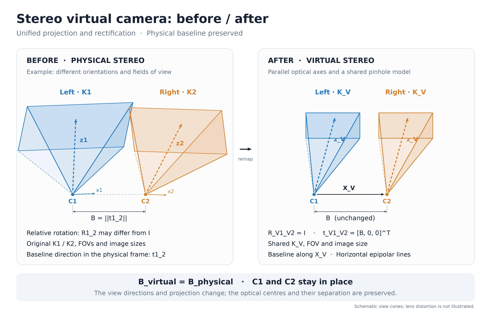

*图 16｜示意图，取自已有的原理文章。左右虚拟相机共用投影模型和朝向，但仍分别位于原来的左右光心，距离 B 不变。视锥只用于说明几何关系，不代表任何一款设备的实测 FOV。*

沿用第三章的变换方向：`T_A_B` 把 B 系坐标变换到 A 系。记物理左、右相机为 1、2，虚拟左、右为 V1、V2；若输入为右到左的 `T_1_2`，则 `t_1_2` 表示右光心在物理左坐标系中的位置。

实现时先把真实基线方向定为虚拟 X 轴，再参考左相机的前向定出另外两条轴，得到物理左到虚拟左的旋转。物理右用对应的旋转转到同一朝向：

```
B = ||t_1_2||
R_V1_1 · t_1_2 = [B, 0, 0]ᵀ
R_V2_2 = R_V1_1 · R_1_2

虚拟右 → 虚拟左：R_V1_V2 ≈ I，t_V1_V2 = [B, 0, 0]ᵀ
```

“基线沿 X 轴”只是换一个坐标系表达真实的光心连线，相机并没有移动。以虚拟左为三维参考时，右投影矩阵的平移方向相反：

```
P_V1 = K_V [I | 0]
P_V2 = K_V [I | (−B, 0, 0)ᵀ]
```

所以右到左外参里的 `+B` 和右投影矩阵里的 `−fxB` 并不矛盾。第四章的深度公式仍然成立，但要用当前虚拟焦距、当前输出像素尺度下的视差，以及该样例自己的基线。本节两款设备的 `K_V` 相同，基线不同：`unitree_gd1` 约 59.914 mm，Ego-Air 按 SEUCM 标定算出约 65.216 mm。不同型号、不同模型分支的内外参要成套使用，不能只换畸变系数而沿用另一组基线。后面跨型号结果统一的是观测接口，两台设备仍是两台不同的物理相机。

生成图像时，从输出到输入做反向映射：

```
虚拟像素 p_V
  → r_V = K_V⁻¹ p_V
  → r_i = R_Vi_iᵀ r_V
  → 按物理相机模型投影 p_i = π_i(r_i)
  → 在原图插值采样，得到虚拟图像
```

单路映射只旋转射线，不加平移，所以不需要场景深度。标定和输出配置固定后，映射表可以预先算好，再逐帧重采样。如果要改变光心、统一不同设备的物理基线，问题就变成了新视角合成，通常需要深度、三维重投影和遮挡处理；只改参数或做二维 Warp，一般恢复不了没被观测到的区域。

### 5.3 真实输出

#### 5.3.1 Ego-Air：标准视图与有效区域

本例用的是 Ego-Air 的另一个会话 `episode_20260720_150841`，与第四章的深度示例不同。前期在该设备数据上的对比显示，SEUCM 的去畸变效果优于 PDCM，所以本节选用 SEUCM，按该分支完整的内参、畸变参数和外参重新生成虚拟双目，图像、旋转、基线和有效区域都随之更新。这一结论只针对当前设备和数据，不是镜头模型的普遍排名。

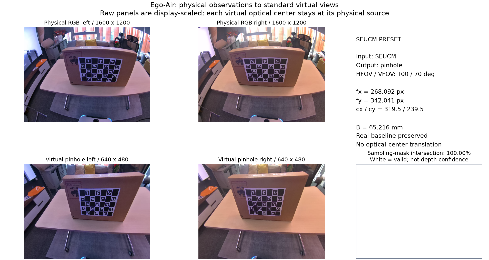

*图 17｜上方为原始 1600×1200 RGB 双目，下方为同光心重映射后的 640×480 虚拟双目，原图只在排版时缩放。右侧是输出参数和两路 Mask 的同坐标交集。该配置下左右几何采样有效率均为 100%；白色 Mask 不表示所有像素都有可靠深度。*

Mask 由每个输出像素在原图中的采样坐标得到：坐标有限，并且离图像边界至少一像素。它只说明该像素有可采样的源坐标，不检测纹理、模糊、遮挡、镜头有效成像圈或匹配置信度，与第四章的深度有效区域也不是一回事。

同坐标交集 `valid_1 ∧ valid_2` 适合展示几何采样覆盖，但双目对应点的横坐标通常不同。实际匹配时要分别检查左像素 `(u_left,v)` 和右候选 `(u_right,v)` 是否有效；交集全白，不代表任意深度、任意目标都有无遮挡的左右观测。

虚拟 FOV 选大了，边缘拉伸和无源区域会增加；选小了，可能丢掉手物操作需要的周边信息。提高输出分辨率也不会多出光学细节。覆盖、采样密度和有效区域要按任务取舍，“没有黑边”不该是唯一目标。

#### 5.3.2 Ego-Air 与 unitree_gd1：不同输入，共用输出定义

`virtual_results_vfov70` 结果包含两款设备各自的虚拟左右图、虚拟标定，以及以虚拟图为输入算出的视差、米制深度和点云，可以直接比较两种物理输入如何进入同一个观测接口。

| 型号 | 物理单目输入尺寸 | 输入成像模型适配 | 虚拟单目输出尺寸 | 保留的基线／mm |
|---|---|---|---|---|
| Ego-Air（ego_air） | 1600×1200 | SEUCM，沿用前期验证后的选择 | 640×480 | 65.216 |
| unitree_gd1 | 640×480 | PDCM／Brown-Conrady，包含 k3 | 640×480 | 59.914 |

Ego-Air 继续用 SEUCM，`unitree_gd1` 按自身标定中的 Brown-Conrady 模型接入。统一接口不需要统一物理镜头模型，各自的物理投影正确适配后，输出到同一个虚拟针孔定义即可。

两份结果 JSON 里，左右共四个 `K` 矩阵完全相同，输出尺寸都是 640×480，由内参反算的名义 FOV 为水平 100°、垂直 70°，与 5.1 节一致。两款设备深度处理的输入图，也分别与各自保存的虚拟左右图逐像素一致。这里核对的是派生结果之间的关联；两款设备的图像没有相互对齐，像素内容也不要求一致。

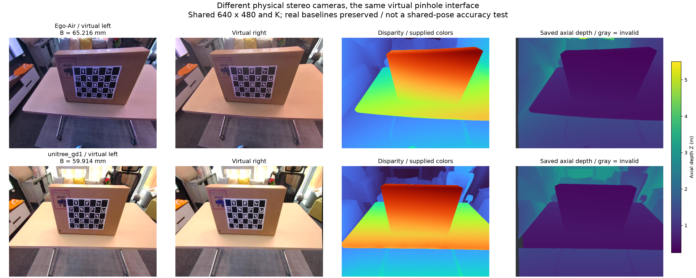

*图 18｜直接读取已有结果：上排 Ego-Air，下排 `unitree_gd1`；从左到右为虚拟左图、虚拟右图、原有视差伪彩图及米制深度。深度统一用 0.25–5.5 m 色条显示，灰色为非正值或非有限值区域；色条只用于比较显示，不是量程承诺。视差保留各自原始配色，不能跨设备按颜色比较数值。*

对下游来说，处理模块可以读入相同尺寸的图像，按同一个 `K_V` 解释像素视线，再使用以米为单位的深度，不必分别处理两套原始镜头模型。但从双目匹配到深度这一步仍要用各自的基线：即使 `K_V` 相同，右投影矩阵的平移项和 `Q` 也不能在两款设备之间复用。同一深度下两者的视差可以不同，这是保留真实物理尺度的结果。

两组观测不是在同一相机位姿、同一曝光条件下同步采集的，所以不能用物体在图中的大小、颜色或估计深度是否相等来评价虚拟化质量。图中深度直接读取已有的 `depth_meter.npy`，没有从视差色图反算，也没有重新运行深度估计或引入独立测距真值。模型版本、数值视差和绝对深度误差还要另外关联和评估。

结合第四章，三种操作的区别如下：

| 操作 | 主要目标 | 不能据此推导的结论 |
|---|---|---|
| 双目极线校正 | 将可信对应约束为水平搜索，便于视差和深度估计 | 图像看起来对齐，不代表标定与同步已通过精度验收 |
| 多目全景拼接 | 将多路观测组织为更宽的展示视野 | 多光心近场场景不能因此变成一台理想针孔相机的真实观测 |
| 虚拟相机映射 | 定义输出投影、视线与坐标接口；本例同时完成双目校正 | 统一投影不等于统一光心、基线、成像质量或世界位姿 |

我们还运行了实现自带的 Ego-Air 坐标代数和合成投影闭环检查，核对变换方向、像素尺度和深度公式。这些检查代替不了真实图像上的独立对应检查，第四章发现的实测残差也仍然存在。图 17 是可复现的单型号观测转换，图 18 是两款设备的已有处理结果，两者都不是新的绝对精度验收。

### 5.4 交付契约

虚拟化层要告诉下游：用的是什么投影，从哪个光心观察，对应哪个时间，哪些区域可用。当前实现做到了其中一部分。下表把内存中的模型、已有的文件输出和完整交付能力分开列出：

| 交付内容 | 当前已有 | 正式交付仍需明确或补齐 |
|---|---|---|
| 虚拟图像与内参 | 左右 PNG；JSON 中的尺寸、左右 K | 虚拟配置标识、名义 FOV 定义及裁剪／缩放记录 |
| 物理—虚拟关系 | 本章生成的 Ego-Air JSON 有两路旋转与 tx=B；所提供的两款结果 JSON 含尺寸、K 和 tx；模型内另有投影矩阵及 Q | 明确变换方向和米制单位，补齐结果快照中的物理—虚拟旋转，并按输出坐标更新与 IMU／地图的外参 |
| 原始投影与模型适配 | 当前实现含 PDCM、SEUCM 分支；Ego-Air 选用 SEUCM，unitree_gd1 使用 PDCM | 分开标识输入镜头模型与输出针孔模型；其他模型需适配、验证后再接入 |
| 有效区域 | 模型内生成 valid_1、valid_2，本章复现另行导出 Mask | 将各路 Mask 与具体输出绑定，区分几何采样、匹配和深度置信度 |
| 时间与来源 | 本例可追溯原始左右图及标定快照 | 将各路原始时间、配对关系、设备／会话与源帧标识写入逐帧关联 |
| 处理与质量状态 | 本章记录输入摘要、配置及复现检查 | 将版本、失败标记和任务验收结果纳入批量处理与交付流程 |

例如本章生成的 Ego-Air JSON 中，`camera_model` 记录的是输入的物理模型分支，下游可能误以为虚拟输出仍带这种畸变。两款结果 JSON 还没有写入这个字段和物理—虚拟旋转，单靠这两份简化文件还原不了全部处理配置。相机—IMU 或地图位姿也不能原样套到旋转后的虚拟相机上，要组合物理—虚拟变换才能得到对应关系。几何转换不改写曝光时刻，不补偿时钟漂移，也不补回缺失帧。

原理和实现分别参考[已有虚拟相机文章](../../calibration/docs/09_双目虚拟相机_博客与示意图3/09_虚拟相机目的和原理_单目与双目虚拟方法_含示意图.md)和[虚拟双目代码](../../calibration/stereo_virtual/get_virtual_stereo.py)。本章配图和检查可用[本章复现脚本](blog_sum_assets/build_virtual_camera_figures.py)生成；[SEUCM 虚拟标定](blog_sum_assets/virtual_stereo_calibration.json)、[左图](blog_sum_assets/virtual_stereo_left.png)、[右图](blog_sum_assets/virtual_stereo_right.png)、[参数与输入摘要](blog_sum_assets/virtual_stereo_audit.json)、[左目 Mask](blog_sum_assets/virtual_stereo_mask_left.png)、[右目 Mask](blog_sum_assets/virtual_stereo_mask_right.png)及[同坐标交集 Mask](blog_sum_assets/virtual_stereo_mask_intersection.png)随文附上。摘要中还记录了 `virtual_results_vfov70` 两款结果的来源、参数和文件校验值，把本章重建的结果和已有推理输出分开。这些导出文件不是完整的生产交付协议。

Ego-Air 与 `unitree_gd1` 的结果说明，原始分辨率和成像模型不同的设备，可以接入同一个虚拟针孔规范，同时保留各自的基线和观测条件，硬件差异仍然存在。图像、几何、时间、有效区域和来源记录相互对应之后，下游在更换设备时可以复用处理逻辑，并判断哪些观测适合当前任务。

---

## 第六章：让质量验证进入规模化数据生产

一组样例能完成深度估计、全景拼接和定位，只是起点。规模化生产还要回答两个问题：换一台设备、换一个采集人员、连续工作一段时间后，数据是否仍然适合目标任务；出了异常，能否直接定位到具体传感器、时间区间和处理版本，不必重看整段视频。

质量管理要回答的是：哪些观测在什么条件下可以用于什么任务，并保留支持这个判断的证据。一个笼统的“好／坏”回答不了这个问题。本章从前文的样例检查出发，说明如何把这些检查组织成可重复的生产流程。下文的质量门控与异常闭环是工程设计，尚未在全部设备、全部批次上部署自动验收。

### 6.1 检查前移：先确认采集条件，再评估处理结果

问题发现得越晚，修复成本越高。如果采集结束后才发现腕部相机偏离操作区、IMU 时间解释不了或者标定绑定错了，视频即使能正常播放，也可能完成不了原定任务。

- 采集前核对身份和配置：设备与传感器流、分辨率和帧率模式、IMU 单位、硬同步分组、会话使用的标定快照，以及供电、存储和录制链路。佩戴后先做一段包含转头、伸手和近场操作的短试采，检查实际覆盖；相机能出图还不够。
- 采集中留意状态变化：遮挡、松动、曝光变化、记录中断和存储异常。有实时检测条件就尽早提示，没有的话也要通过阶段性回看缩短反馈周期。录制没有中断，不代表每一路流都正常。
- 采集后先查基础记录，再跑重处理：先核对文件可读性、流归属、时间序列和采样覆盖，再生成虚拟视图、深度和轨迹。基础关系没确认之前，后续算法即使输出了结果，也不应交付。

标定是否仍然适用也要定期复查：开机初期与持续运行后、反复佩戴或拆装前后，在受控场景中用同一组参数复测。比较时要控制场景和成像条件，把设备整体移动、匹配波动和相机间关系变化区分开；误差变了，不一定是标定漂移。

### 6.2 按帧、片段和会话分层判断

单帧问题、连续性问题和来源问题影响的范围不同。图像模糊可能只影响一小段操作；时间中断可能切断轨迹；标定与设备绑定不明，则可能影响整个会话的几何解释。检查结果要保留各自的粒度，一个平均值会掩盖局部失败。

| 检查对象 | 建议记录的指标与单位 | 判定粒度与解释 |
|---|---|---|
| 图像可用性 | 清晰度指标、过曝／欠曝像素比例、异常黑帧及重复帧 | 帧级检测并汇总到片段；结合操作区域，不能将低纹理直接等同于失焦，也不能仅凭低运动判定重复帧 |
| 时间与配对 | 时间戳回退／重复、相邻采样间隔、配对时间差及缺口时长 | 在已确认的各流时钟语义下统计；图像配对差不是曝光同步精度，帧数也不能代替时间覆盖 |
| IMU 连续性 | 采样间隔、缺失区间、非有限值、饱和或异常跳变 | 同时看 IMU 流和图像覆盖；静止片段可辅助检查偏置与幅值，动态加速度偏离重力幅值本身不构成故障证据 |
| 几何与派生结果 | 独立对应点残差／px、几何采样 Mask 覆盖、深度输出有效比例及独立参考误差 | 按视场位置、距离和场景分组；区分像面、虚拟配置与筛选规则，不把数值有效当作物理准确 |
| 连续定位与任务覆盖 | 跟踪中断次数与时长、查询接受比例、有效轨迹区间、关键操作区可见性 | 片段级评估；区分本地 VIO 延续、地图重定位和回放插值，记录所需模态共同有效的时间区间 |
| 来源与接口一致性 | 设备／标定绑定、尺寸及单位匹配、输入摘要、处理配置关联 | 会话与产物级检查；必要来源无法确认时应进入待核验，不能靠猜测流名或填默认值补成“正常” |

前文已有混用指标的例子：第五章的几何采样 Mask 全白，深度并不因此全部准确；第四章的腕部查询接受比例，也不是原始视频的可用帧比例。即使各路单独的有效率都很高，也要检查它们是否覆盖同一段关键操作；几个总体比例相乘，得不出跨设备观测是否可用。

### 6.3 门控阈值从任务要求出发

判定分两类。尺寸、字段、单位或来源关系违反既定输入契约，是可以明确识别的一致性问题。模糊程度、时间配对误差、几何残差和跟踪覆盖是否足够，则取决于任务和场景，需要经过验证的阈值。

例如，静态背景的拼接和快速抓握对时间差的容忍程度不同，近距离接触分析和粗粒度场景识别对图像细节和深度误差的要求也不同。同样大小的像素残差，在不同输出焦距、分辨率和目标距离下，对三维结果的影响并不相同。

阈值要用有代表性的设备、佩戴方式、光照、距离和运动条件来制定，并在没参与调参的验收样本上复核。制定时除了平均值，还要看误差尾部、持续异常的区间，以及自动判定和人工复核不一致的情况。不能先剔除困难样本，再拿剩下的结果代表整体质量。

没有任务阈值或独立参考时，状态记为“已测量、待判定”或“证据不足”，不自动记为通过。缺的证据如果关系到任务必需的能力，该用途的验收就暂缓；如果只限制了某种派生任务，可以保留原始数据并写明允许的用途，这种限制不能藏在一个会话级总分里。

通用阈值还没有建立，本章不预填；第四章单个样例的残差、深度有效比例或定位结果，也不能直接当作全设备的验收线。

### 6.4 异常处置闭环

检测到问题之后要决定怎么处理。适配或配置错误可以通过重处理修复；曝光时已经丢失的细节、没记录下来的传感器采样、没被观察到的区域，换后处理参数也恢复不了。

面向批量处理，异常处置可以组织为以下流程：

```
原始记录＋设备／标定快照
  → 完整性、时间与图像检查
  → 面向目标任务的几何与连续性检查
  → 带时间区间、方法与版本的质量记录
      ├─ 满足当前任务要求 → 按确认的可用区间交付
      ├─ 证据不足         → 待核验／补充评估，不混入已通过结果
      └─ 明确异常         → 保留异常区间与原因，进入复核
                              ├─ 适配／配置问题 → 新版本重处理 → 复验
                              └─ 采集信息缺失   → 重采或明确限制用途
```

原始数据和失败片段都要保留。修复时生成新的派生版本，不覆盖原文件、不改写源时间戳，也不靠删掉异常来提高通过率。复核时还要记录问题归因、处理决定和复验结果，让同类问题能反馈到设备检查、佩戴说明或处理配置里。

如果只交付部分片段，要保留裁剪边界及其与原会话的对应关系。对 VIO、运动分析等连续任务，不相邻的合格片段不能直接拼成一条“连续”序列，相关的图像、IMU、时间映射和状态初始化范围都要重新核对。

版本变化也要沿依赖链处理。更换标定快照、时间映射、SEUCM 适配实现或虚拟内参后，受影响的校正图、深度、位姿和质量结论要重新生成或验证。旧结果可以保留作比较，但旧版本的“通过”状态不能直接继承给新产物。

### 6.5 批次报告

本文附上了[双目与定位检查记录](blog_sum_assets/validation_audit.json)、[匹配与回投记录](blog_sum_assets/feature_reprojection_audit.json)、[虚拟相机与跨型号输入摘要](blog_sum_assets/virtual_stereo_audit.json)，以及第三章的标定布局计算记录。这些材料把来源、参数和部分结果关联了起来；它们各自的样本范围和评估性质也要一并记录。

| 本文已有的证据 | 可以支持的判断 | 规模化验收仍需补充 |
|---|---|---|
| 单帧双目对应统计、视差与深度单位检查 | 当前图像的对应表现及该处理结果的尺度自洽性 | 多会话、分区域与分距离统计，以及独立深度参考 |
| 同相机／跨设备匹配图，以及 head cam0 关键帧 112 的地图点回投 | 共同场景存在候选关联；当前选定地图点的跨关键帧几何一致性可量化检查 | 匹配内点及覆盖统计、全会话分运动条件的残差分布；不能以单帧内部残差替代独立精度 |
| 连续定位回放与跨设备查询记录 | 当前样例能够建立共同观测并输出统一空间中的轨迹 | 中断／恢复区间、任务覆盖和独立轨迹或相对位姿参考 |
| 两款设备的虚拟参数、输入摘要与结果关联 | 在保留各自基线时，共用虚拟投影定义与输出接口 | 更多设备与批次的适用性检查，完整处理版本和逐帧质量关联 |
| 本文样例的检查与复现材料 | 具体结果有据可查，部分链路可复现 | 已复核的门控规则、跨批次质量分布及异常处置统计 |

批次报告要按型号、设备标识、采集模式、标定与处理版本以及场景条件分组，差异才能解释。通过率必须注明分母是帧、配对组、查询关键帧、片段、会话还是时长；处理失败、未计算和证据不足也要单列，不能从分母里悄悄消失。片段长短不一时，按片段数统计和按有效时长统计是两种口径，要分别说明。

回到开篇整理酒店桌面的动作。最终要确认的是：水杯放回托盘、拾起纸巾、手靠近垃圾桶这几个关键阶段，有没有清晰且时间关系可信的观测，所需的几何和运动信息是否适用，出了异常能否追溯和复核。录制时长本身说明不了这些。

硬件提供观测，标定定义时空关系，虚拟相机统一接口，质量闭环决定哪些数据能用于哪些任务。高质量的第一人称具身数据，在录制之外，还要经过系统的设计、验证和交付。

---

## 附录 A：设备规格来源与样本模式说明

### A.1 补充规格

设备表中 Ego-Air 的分辨率与帧率采用已确认的采集配置，其余采用规格书模式；FOV 为规格书标称值，H／V 分别表示水平／垂直视场，不等同于实测有效覆盖。各款设备均采用全局快门，资料未给出读出时长。

Ego-Air 的规格书 RGB 对角 FOV 为 179.2°；整机 4 GB 内存、32 GB 存储，支持 TF 卡扩展，供电 5 V／3 A，重量未给出。Duo 的规格书注明光学 FOV 可能存在 3°误差。Ultra 另支持 1920×1200、30 fps，以及 1920×1080、30／60 fps；1920×1200 模式的单路标称 H186°／V128°、拼接 H302°。Finger 的 RGB 对角 FOV 标称 188°。Duo 与 Wristcam 采用自然散热。

### A.2 规格书与样本模式的差异

FOV 表格引用的是规格书数值，不是有效覆盖的实测。H、V 和对角分别表示水平、垂直及对角视场；单路视场与拼接视场不能混用，多路角度也不能直接相加。Ego-Air 的实际采集模式与规格书不同，不能用规格书 FOV 代表当前模式的有效视场，应以对应标定的内参反投影和有效区域验证为准。

资料中的模式、实际配置和实测表现要分开看。Ego-Air 以采集方确认的实际配置为准：4 路灰度鱼眼各 640×480、30 fps，一组 RGB 双目各 1600×1200、60 fps，IMU 采样率 500 Hz；规格书中与实际数据不一致的图像模式不沿用。Ego-Mate-Duo 资料为 1600×1200、30 fps，新样本元数据标称 60 fps，旧联合样本为 1600×1300、30 fps；Ego-Mate-Ultra 当前标定样本元数据标称 30 fps，Finger 样本标称 60 fps。这些配置帧率不等于逐帧统计得到的有效帧率。Ego-Air 的四路灰度鱼眼在样本中组合记录为 640×1920 的流，做单相机几何计算时仍要还原为各自的 640×480 图像。

输出尺寸变了，标定也要同步更新。当前 Ego-Mate-Wristcam 的 1600×1300 标定如果用于演示 1600×1200 输出，可以把顶底各裁去 50 像素作为图示假设；Ego-Mate-Finger 的单色 IR 视图从 1280×960 等比例调整为 1600×1200，同样只是演示口径，不代表已经验证的采集模式。实际部署要确认裁剪或缩放流程，并更新内参和有效区域。Ego-Mate-Ultra 的整机规格资料与本次四目标定样本是否对应同一硬件修订版本，正式发布前还要核对。

规格来源：以下页码按 PDF 文件页序计，核对日期均为 2026 年 11 月 13 日。

- [Ego-Air 配套规格资料 V2.7](诠视sepcs/SeerFusion%20One_V2.7cn.pdf)，第 2 页；资料版本标为 2026-V2.7，日期为 2026 年 10 月 20 日。分辨率、帧率和 IMU 采样率采用采集方确认的实际配置，不直接沿用资料中的图像模式。
- [Ego-Mate-Duo 配套规格资料 V2.0](orbbec_specs/ORBBEC%20EGO-2%20规格书%20V2.0-20261109.pdf)，第 4–5 页，采用鱼眼版参数；重量采用规格表口径，不混用介绍页的相机重量。
- [Ego-Mate-Ultra 配套规格资料 V1.1](orbbec_specs/ORBBEC%20EGO-4B中文规格书-V1.1-20261011.pdf)，第 4–5 页，采用鱼眼版参数。
- [Ego-Mate-Wristcam 配套规格资料 V1.1](orbbec_specs/ORBBEC%20Wrist-1中文规格书.pdf)，第 4–5 页。
- [Ego-Mate-Finger 配套规格资料 V1.0](orbbec_specs/ORBBEC%20数采设备UMI%20Finger规格书%20V1.0.pdf)，第 4–5 页；接口采用规格表的 USB 3.0 口径，介绍页另写 USB 2.0，正式部署前需核对实物版本。
