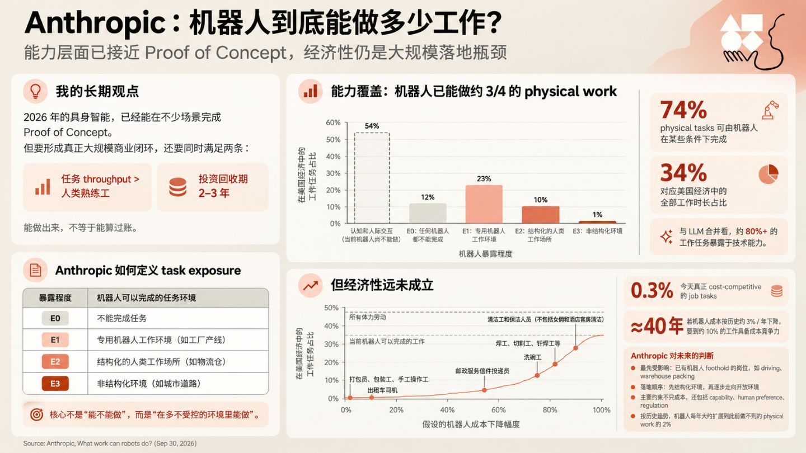
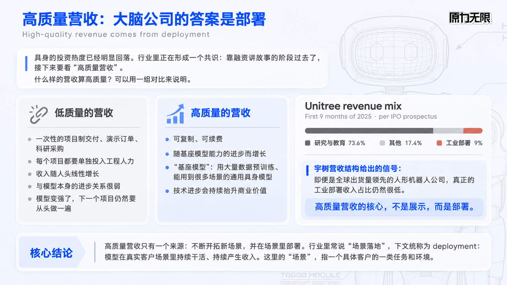
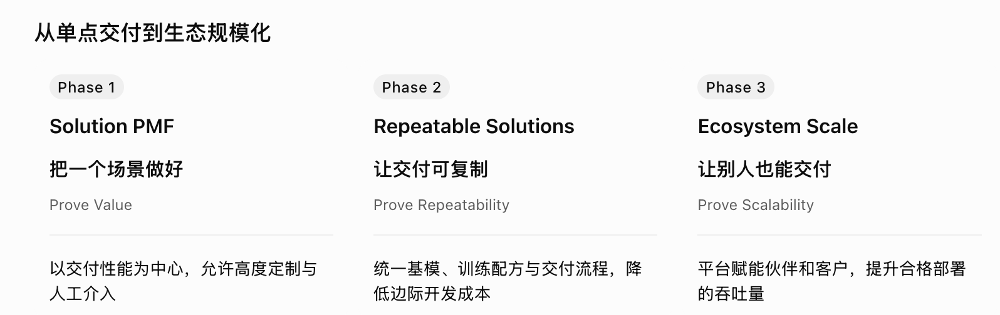
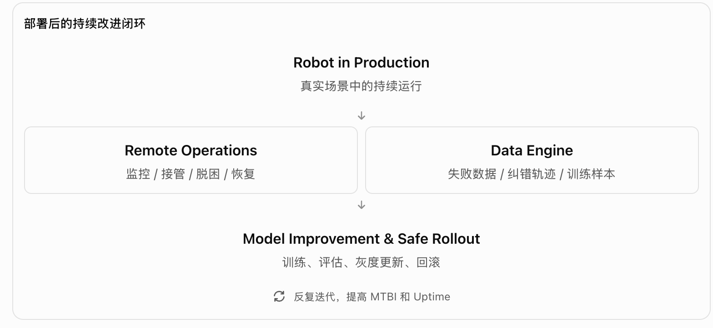
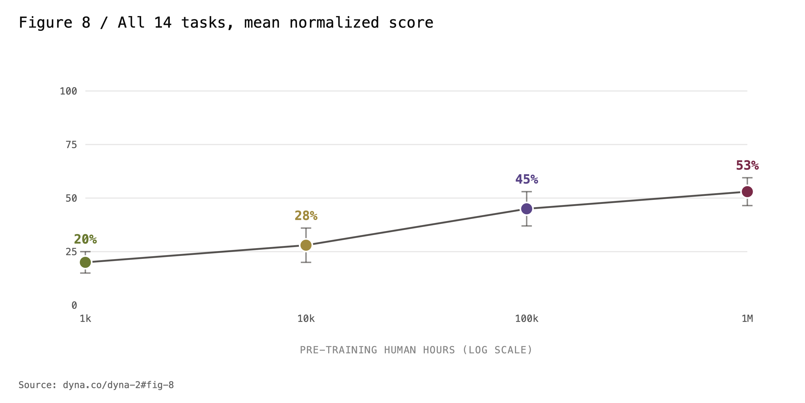
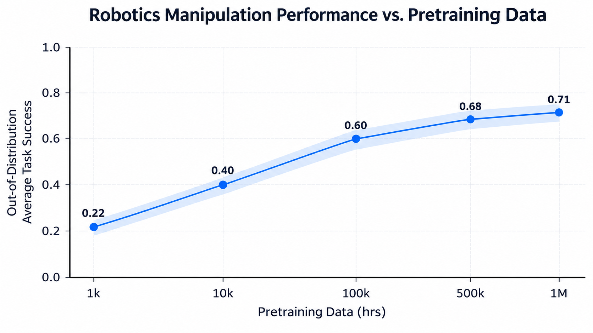
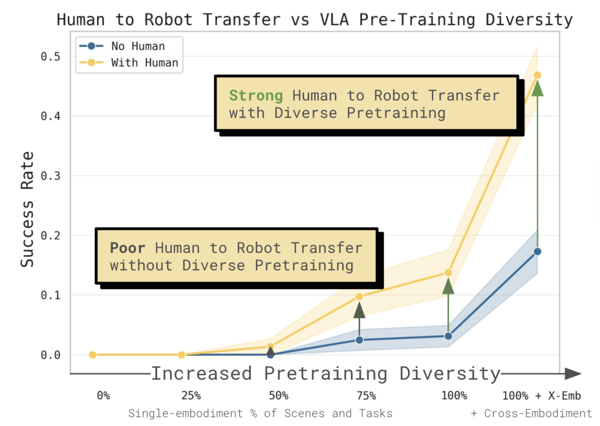
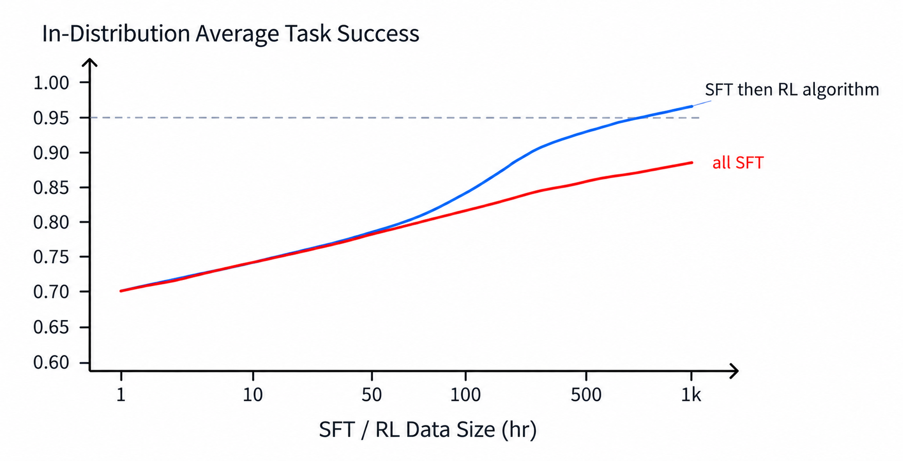
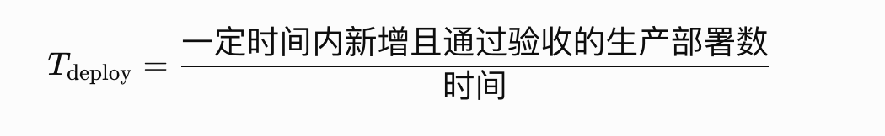

具身智能的投资热度已经明显回落。行业里正在形成一个共识：靠融资讲故事的阶段过去了，接下来要看高质量营收。可放眼整个行业，能拿出高质量营收的具身公司还很少。

卡在哪里？技术上能做到，和商业上算得过账，中间还隔着很长一段路。Anthropic 在 2026 年 9 月发布的研究 [*What work can robots do?*](https://www.anthropic.com/research/what-work-can-robots-do) 给了一组数字：在某些条件下，74% 的 physical tasks（体力类工作任务）已经可以由机器人完成，对应美国经济全部工作时长的 34%；而今天真正 cost-competitive（在成本上比人划算）的工作任务，只占 0.3%。如果机器人成本按历史上每年约 3% 的速度下降，要大约 40 年，才会有 10% 的工作在成本上划算。

什么样的营收算高质量，可以拿低质量的营收来对照。低质量的营收，是一次性的项目制交付、演示订单、科研采购。每个项目都要单独投入工程人力，收入随人头线性增长，和模型本身的进步关系很弱：模型变强了，下一个项目仍然要从头做一遍。

高质量的营收可复制、可续费，并且随 Foundation Model（具身基础模型：用大量数据预训练、能用到很多场景的通用"大脑"模型）的进步而增长。

宇树（Unitree）是全球出货量领先的人形机器人公司。据其 IPO 招股书，2025 年前 9 个月，它的收入里研究与教育占 73.6%，其他占 17.4%，工业部署只占 9%。

高质量营收只有一个来源：不断开拓新场景，并在场景里部署。本文说的"部署"，指模型在真实客户场景里持续干活、持续产生收入；"场景"指一个具体客户的一类任务和环境。

我们团队的做法分三个阶段：

1. Performance-Driven Solution Delivery：以客户现场的生产表现为中心，先把一个场景做好。
2. Foundation Model-Based Repeatable Delivery：用同一个 Foundation Model 驱动多个场景，让交付可以复制。
3. Platform-Enabled Ecosystem Scaling：把模型能力、工具链和交付经验产品化，让外部团队也能完成部署。

三个阶段分别回答三个问题：Does it work? Can we repeat it? Can others scale it?

只有这样走，才能既有高质量营收，又拾级而上地走向平台。三级台阶从易到难，每一级都踩在上一级的成果上。整个过程中，我们卖给客户的始终是解决方案（交给客户的一整套自动化系统）带来的自动化价值，Foundation Model 是这套解决方案的技术内核。随阶段变化的，是解决方案怎么被生产、由谁交付、能复制多快。我们把这条路叫作 Solution First, Platform Later。

## 拾级而上：为什么是这个顺序

三个阶段的顺序由技术难度决定。它们从易到难排列，技术瓶颈不允许跳过任何一级。

第一级，一个场景达到生产要求。为了做到这一点，用什么手段都可以：为这个场景单独训练的模型、专用控制器、规则、对场景本身的改造，以及 Remote Assistance（远程辅助：后台有人实时看着，机器人卡住时远程接管、帮它脱困）。

"生产要求"是一道很具体的门槛。MIT 教授、Walden Robotics 创始人 Russ Tedrake 在 CoRL 2026 的演讲 *Learning in the factories: from the research lab to deployment to real customer value* 中，给出过这样一组数字：

| 指标 | Uptime | Defect / Mistake Rate | Safety Incidents / Line Slowdowns |
|---|---|---|---|
| 数字 | 98.5% | < 0.5% | 0 |

Uptime 是机器人能正常干活的时间占比；Defect / Mistake Rate 是机器人干的活里出错的比例；最后一项要求既不出安全事故，也不拖慢客户原有产线的节奏。

第二级，多个场景共享一个 Foundation Model，每个场景各自达到同样的生产要求。这要求 Foundation Model 本身足够强，从它适配到每个具体场景的过程也要可控。

第三级，不掌握核心模型研发能力的 Partner（生态伙伴：系统集成商、行业伙伴，以及有能力的终端客户）也能把方案复制到合格。这要求模型适配、部署验证、上线运维都被做成工具，外部团队可以自助完成。

每一级的产出都是下一级的前提。没在真实场景里做到合格，就谈不上让多个场景共享 Foundation Model；多个场景的交付还没变成可重复的标准流程，就没有东西可以交给 Partner。

营收质量也随着台阶往上走。拿开篇那几条标准逐级看：

| | 第一阶段 | 第二阶段 | 第三阶段 |
|---|---|---|---|
| 来自部署，不是展示 | 是 | 是 | 是 |
| 可复制 | 否，每个场景单独投入工程人力 | 是，多个场景共享 Foundation Model 和交付流程 | 是，由 Partner 复制 |
| 随 Foundation Model 进步而增长 | 弱 | 强 | 强 |
| 开发人力投入随业务线性增长 | 是 | 部分，交付仍靠我们自己的工程师 | 否 |

必须承认，第一阶段的收入带着低质量营收的特征：每个场景都要单独投入工程人力，Foundation Model 进步带来的收益也有限。这是当前的技术条件决定的。但它已经跨过了最基本的一条：收入来自真实部署，不是展示。后两级要做的，就是把这份部署收入一项项变成高质量营收。

与此同时，限制规模的瓶颈也在转移：第一阶段是单个项目的工程能力，第二阶段是我们自己交付团队的产能，第三阶段是 Partner 的产能和平台的支持能力。

从第一级往上走，每一级能不能开始，都有明确的前提。后文在对应阶段的开头分别讲。

## 第一阶段：Performance-Driven Solution Delivery

这一阶段的目标，是证明单个自动化解决方案的商业价值，而不是证明通用模型能力。

我们只盯一件事：交付客户认可、能持续运行的自动化服务。上一节的生产要求是门槛，日常盯的是下面这组指标：

| 指标 | MTBI | Defect / Mistake Rate | Uptime | Task Success Rate | Cost per Task |
|---|---|---|---|---|---|
| 优化方向 | 越长越好 | 越低越好 | 越高越好 | 越高越好 | 具备商业可行性 |

MTBI 是平均多久需要人插手一次；Task Success Rate 是交代的任务有多大比例能做成；Cost per Task 是机器人完成一件任务的成本。最后这一项对应开篇那个 0.3%：活能干出来还不够，每件活的成本要让客户算得过账。

为了达到这些指标，我们针对具体客户、具体任务，选最有效的工程与算法组合：定制模型、专用控制器、规则、场景改造，以及 Remote Assistance。同时，有三件事这一阶段刻意不去优化：不要求不同场景共用同一个模型，不要求方案能迁移到别的场景，也不把首次部署的开发周期和开发成本当作核心目标。

这样取舍，是因为第一级台阶只需要回答一个问题：Does it work? 在真实生产环境里做到客户认可的表现，本身已经很难。如果同时还要求通用、可迁移、开发成本低，等于站在第一级台阶上去够第三级的东西。通用性留给下一级。

> TODO：待加入真实的场景开发。

所以我们交给客户的是一整套自动化系统：Autonomy + Remote Assistance + Continuous Improvement。

Remote Assistance 在这套系统里有两个目的。

第一，让方案先部署出去。解决方案的能力还没完全达到部署要求时，模型做错了，由人来兜底。客户拿到的是稳定的生产表现，不必等模型做到完美才开始用。

第二，形成 RL（强化学习：机器人从真实运行中的成败和人的纠正里学习，越做越好）闭环，让人的介入越来越少。每一次人工接管都会留下一条纠错记录，这些记录回到训练里，模型下次就少犯同样的错。人的介入就是运营成本：介入越少，MTBI 越长，Cost per Task 越低。

> TODO：待加入 RL 闭环的流程图。

这个闭环有四个环节。机器人在真实场景中持续运行；Remote Assistance 负责监控、接管、脱困和恢复；Data Engine（数据引擎：把失败和人工纠错的记录变成训练样本的流水线）收集失败数据和纠错轨迹，整理成训练样本；模型在此基础上训练、评估，先在少量机器人上灰度更新，再逐步铺开，出了问题可以回滚。一圈一圈转下来，MTBI 和 Uptime 持续提高。

Remote Assistance 会贯穿三个阶段。到了第三阶段，它是我们提供给 Partner 的平台能力之一。

<!-- TODO：目标行业材料（用户补充），可能放在本节 -->

这一阶段不追求通用性，核心是先把一个场景做成、做好、做稳定。

## 第二阶段：Foundation Model-Based Repeatable Delivery

第一阶段回答了 Does it work?，第二阶段要回答 Can we repeat it?。这是整个商业模式里最关键的一次能力跃迁。

这一阶段的目标，是从多个各自独立的解决方案，转向由同一个 Foundation Model 驱动、可以系统化生产的解决方案。第一阶段里，每个场景可以单独开发；到了第二阶段，几个 Flagship Application（旗舰场景：被选中重点打磨、后续要大规模复制的少数几个应用）共享同一个 Foundation Model，再通过 Mid-training、Post-training 或场景适配，各自达到部署要求。

### 进入这一阶段的前提

第二阶段有门槛：Foundation Model 要先具备一定的能力，具体看三项。

#### Zero-shot / One-shot 能力

横轴是 pretraining data 的规模，纵轴是模型在 out-of-distribution 任务上的表现。衡量这种表现的指标有很多种，MSE、accuracy@0.5、success rate、throughput 都可以。我们要看到的是，这些指标在任务泛化性上随数据量有 scaling 效应。

行业里已经有公开的同类曲线。下图出自 [Dyna-2](https://dyna.co/dyna-2#fig-8)，横轴是 pretraining 用的人类数据小时数（对数坐标），纵轴是 14 个任务的平均归一化得分。数据从 1k 小时加到 1M 小时，得分从 20% 涨到 53%。

我们期望的曲线是下面这样：

> TODO：要求待补充。

#### Cross-embodiment transfer 能力

Physical Intelligence 研究过跨本体迁移。下图是他们的结果，模型方法论固定为 π0.5。纵轴是 success rate，两条线分别是不加和加入 ego-centric 数据，绿色箭头是加入 ego-centric 数据带来的提升量。

图里最关键的是最右边两个绿箭头。这两组实验的差别只在于模型训练时有没有加入多样性本体数据，加入之后，ego-centric 数据带来的提升明显更大。他们的结论是，训练数据里的本体多样性越好，ego-centric 数据对模型 performance 的提升越高。

我们期望的成果和这张图类似。

> TODO：Physical Intelligence 原文链接；要求待补充。

#### Mid-training (SFT) → Post-training (RL) 能力

纵轴是 in-distribution task performance。我们关注的是应用场景所在的垂直领域里，期望完成的那些任务做得怎么样，所以看 in-distribution。横轴是 Mid-training (SFT) 和 Post-training (RL) 的数据量。

这条曲线有三个特性。

第一，RL 必不可少。只用 SFT（红线），性能到不了准出线；SFT 之后接上 RL（蓝线），曲线明显变陡，最后越过准出线。所以 Training Recipe（训练配方：把 Foundation Model 适配到新场景的一套标准做法）要先做 SFT，再做真机 RL。

第二，准出线暂时画在 95%。它和客户要求的 Uptime 98.5% 之间仍然可能有差距。有差距也可以先部署：用 Remote Assistance 兜底，部署之后再继续提升。

第三，横轴的数据量要可控，因为这些数据的获取成本会很高。

只有证明了我们有这样的 Foundation Model，才能把商业模式从第一阶段切换到第二阶段。

### 如何实现这样的 Foundation Model

要得到上面期望中的这几条曲线，我们在两个方向上投入：Data scaling 和 Model scaling。

#### Data scaling

Data scaling 要回答的问题是：如何高产能地获取高质量的 ego-centric 数据。我们团队在这上面的布局是[星河数采众包平台](https://www.idatagrid.com/index.html)。

#### Model scaling

Model scaling 要回答的问题是：什么样的模型架构，能让我们得到上面期望中的曲线。我们团队的尝试是 [AtomBrain 系列](https://ultradroid.infiforce.cn/infiforce-research-blog/research.html)。

### 要做的三件事

有了这样的 Foundation Model，第二阶段要把三件事做起来。第一件是统一的 Foundation Model 和 Training Recipe；第二件是标准交付流程；第三件是我们自己的 FDE（前线部署工程师：驻扎在客户现场、把方案做到能用的工程师）团队。

| 要做的事 | 具体内容 |
|---|---|
| 统一 Foundation Model + Training Recipe | 统一数据规范、场景适配的 Training Recipe、评估与版本管理。不同场景尽可能共享 Foundation Model，只对必要的部分做适配。 |
| 标准交付流程 | 场景勘察 → 任务定义 → 硬件适配 → 数据采集 → 训练验证 → 客户验收 → 持续运维，每次部署都照着走。 |
| 自有 FDE 团队 | 由自己的 FDE 完成几个精选的 Flagship Application，吃透客户的行业 know-how、业务流程和异常处理，把项目里的个性化工作不断沉淀成可复用的工具。 |

> TODO：Flagship Application 怎么选（待补充）。

### 核心转变与内部指标

和第一阶段相比，客户那边看的指标没有变，仍然是 MTBI、Uptime、Defect / Mistake Rate 这些生产指标。变的是公司内部：我们开始优化开发效率、复用率和边际交付成本。这是从 project engineering（每个项目从头做一遍）转向 solution engineering（做出一套能反复用的方案）。

第二阶段要在下面这组内部指标上做出成绩。这些指标达标了，才能进入第三阶段：

| 指标 | 衡量什么 |
|---|---|
| Development Lead Time | 新场景从启动到验收的周期 |
| Engineering Hours per Deployment | 单个部署消耗的工程资源 |
| Reusable Component Ratio | 标准能力的复用程度 |
| One-off Customization | 场景专用的开发量 |
| Fine-tuning Efficiency | 达到目标性能所需的数据、算力和周期 |

这组指标往好的方向走，营收质量也就上了一级。回到"拾级而上"那张表：第二阶段的收入变得可复制，并且随 Foundation Model 的进步而增长。不过交付仍然靠我们自己的 FDE，开发人力投入还有一部分随业务线性增长，这要留到第三阶段解决。

第二阶段不必强求零定制。这一阶段的关键，是让定制化工作可收敛、可复用、可规模化。

## 第三阶段：Platform-Enabled Ecosystem Scaling

第三阶段要回答 Can others scale it?。前两个阶段，部署都靠我们自己的团队完成；这一阶段要把模型能力、工具链和交付经验产品化，让外部团队成为部署的主体。

### 进入这一阶段的前提

前提就是第二阶段那张内部指标表。Development Lead Time、Engineering Hours per Deployment 这些指标达标了，说明我们自己已经能按标准的方式反复交付。我们自己还做不到的事，交给 Partner 也复制不出来。

### 部署主体换成 Partner

我们把成熟的 Foundation Model、解决方案模板、开发工具和运维体系打包成一个平台，叫作大脑平台。具体的交付由 Partner 来做。

Partner 的任务有明确的边界：他们做 Replication（复制：把已经验证过的方案搬到相似的场景里），不做 Invention（发明：从零做出新方案）。拿到一个已经验证过的 Flagship Application，Partner 负责把它复制到相似的客户、相似的场景和兼容的机器人硬件上。发明新方案要靠核心模型研发能力，复制已有方案靠的是平台和工具，所以我们不要求 Partner 具备核心模型研发能力。

为了让 Partner 能独立完成复制，大脑平台要覆盖一次部署的全过程：场景配置、数据收集、模型适配、部署验证、上线监控、Remote Assistance 和生命周期管理。

### 北极星指标：Qualified Deployment Throughput

这一阶段最看重的指标是 Qualified Deployment Throughput，即单位时间内新增的 Qualified Deployment（合格部署：达到约定标准、并进入持续运营的部署）数量。

"合格"有明确的含义。机器人装上了、软件激活了，都不算数；要满足约定的 Uptime、MTBI 和任务质量标准，并且进入持续运营，才算一次 Qualified Deployment。

和它一起看的还有三个指标：

| 指标 | 衡量什么 |
|---|---|
| Deployment Throughput | 每月或每季度成功新增多少部署 |
| Partner Autonomy | 多大比例的部署能由 Partner 独立完成，不依赖我们的核心研发 |
| Platform Unit Economics | 每新增一个部署带来的持续毛利，以及它消耗的平台支持成本 |

到了这一级，"拾级而上"那张表的最后一格也翻了过来：交付由 Partner 完成，我们的开发人力投入不再随业务线性增长。

第三阶段成功的标志，不是我们自己部署了更多机器人，而是 Partner 的交付规模增长得比我们的团队规模快。

## 商业模式跟着阶段变

从第一阶段到第三阶段，客户买的东西没有变，一直是自动化带来的价值。变的是我们怎么生产、交付这份价值，以及怎么收钱：

| | 第一阶段 | 第二阶段 | 第三阶段 |
|---|---|---|---|
| 主要产品 | 定制化自动化方案 | Flagship Application 的标准解决方案 | 大脑平台 + 方案模板 |
| 部署主体 | 自有团队 | 自有 FDE 团队 | Partner / 客户 |
| 模型策略 | 场景最优，允许独立模型 | 统一 Foundation Model + 适配 | 平台管理的模型与适配 |
| 技术重点 | 达成生产性能 | 模型与交付复用 | 工具化、抽象化、自助化 |
| 收费方式 | 项目费 + 运维服务 | 标准部署费 + 持续服务费 | 平台授权 / 使用费 + 生态分成 |
| 规模瓶颈 | 单项目工程能力 | 自有 FDE 产能 | Partner 产能与平台支持能力 |
| 核心竞争力 | 真实场景交付能力 | 跨场景复用能力 | 生态规模与平台网络效应 |

收费方式跟着部署主体走。第一阶段每个场景单独开发，收的是项目费，加上部署之后的运维服务费。第二阶段交付的是标准解决方案，收费也跟着标准化，变成标准部署费加持续服务费。第三阶段由 Partner 交付，我们收大脑平台的授权费或使用费，再和 Partner 分成。

核心竞争力也在换位置：第一阶段靠在真实场景里把活干好，第二阶段靠跨场景复用，第三阶段靠生态的规模和平台的网络效应。

## 结尾

回到开篇的问题。具身公司现在缺的是高质量营收，这三个阶段就是我们拿到它的路径：第一阶段先拿到来自真实部署的收入；第二阶段让这份收入可以复制，并随 Foundation Model 的进步而增长；第三阶段让它不再受我们自己团队规模的限制。
